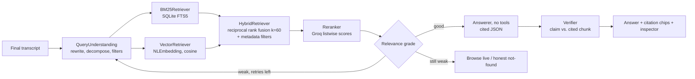

# Runic: plan for the RAG reframe + website + app features

Status: **approved 2026-10-15.** Decisions: RAG core first (steps 0-7), then website, then brief-2 extras. Pricing = Free. Proxy on Vercel (developed locally first). No paid accounts (no Apple Developer team, no Groq Dev tier, no domain): deep links use `runic://` only; Universal Links, iOS App Intent device testing and stable mic permission are deferred; Groq load is spread across models.
Covers both briefs: (1) voice-driven agentic RAG browser, (2) "Roman Forum x Liquid Glass" website + the app features it promises. They share pieces (approval gate, Groq proxy, deep links), so they are planned together.

---

## 0. Where the code is today (verified 2026-10-15)

```mermaid
flowchart LR
  Mic[Mic, always on] --> DG[Deepgram nova-2 stream]
  DG --> VA[VoiceAgent<br/>wake word "Runic", clause split,<br/>instant navigate/search]
  VA -->|intent JSON| G1[Groq gpt-oss-20b]
  VA -->|enqueue task| BA[BrowserAgent<br/>tool loop, max 15 steps]
  Bar[Typed input] --> BA
  BA -->|tools + page snapshot| LLM[LLMService<br/>Groq qwen3.8-27b, fallback gpt-oss-120b/20b]
  BA --> TM[TabManager<br/>WKWebView tabs, DOM element extraction, screenshots]
  Keys[.env bundled as env.txt] -.-> LLM
  Keys -.-> DG
```

| Area | Files (exists today) | Notes |
|---|---|---|
| App shell | `App/RunicApp.swift`, `App/ContentView.swift`, `App/Models.swift` | macOS uses a single `Window`; registers `runic://` (activates app only, no params yet) |
| Voice | `Agents/VoiceAgent.swift` | Deepgram streaming, wake word + 8 s follow-up window, clause splitting, instant navigate/search, intent LLM |
| Acting agent | `Agents/BrowserAgent.swift` | Tool loop, FIFO queue, fork_tasks sub-agents, history compaction |
| Model client | `Services/LLMService.swift` | Groq chat completions, model fallback on 429, terse tool schemas |
| Keys | `Services/Secrets.swift` + `.env` | **Keys are bundled into the app.** |
| Browser | `Browser/TabManager.swift`, `BrowserWebView.swift`, `SiteCacheImpl.swift` | JS bridge, visible-element extraction, `evaluate_js` |
| UI | `Views/*` incl. `VoiceCaptionView` | Live caption, start page, settings |
| Website | `website/index.html` | Static placeholder made today |
| Tests | none | No test target exists |

Swift: language mode 5, `SWIFT_DEFAULT_ACTOR_ISOLATION = MainActor`, Xcode 27 / iOS 27 SDK, deployment 26.2. File-system-synchronized groups (new files under `Runic/` are picked up automatically).

## 1. Conflicts between the briefs and the code (need your call)

1. **BackendService and StoreManager no longer exist.** You asked earlier to make Runic free, so I deleted the paywall, StoreKit and the unused backend login. Brief 1 says to route model calls through BackendService. Brief 2 says to show real StoreKit prices.
   *Proposal:* a new minimal proxy (§3.1), and the Pricing section says "Free" (true today). Alternatively, restore StoreKit if you want paid tiers.
2. **"No API keys in the client" vs. today.** Groq and Deepgram keys ship inside the app (`env.txt`). Fixing this needs a server: Groq calls go through a proxy, and Deepgram uses short-lived tokens minted by the proxy (Deepgram supports temporary keys via its API; to be verified at build time).
3. **Groq has no embeddings or rerank endpoint.** Your key's `/models` list has no embedding model, and the embeddings docs URL returns 404. Plan: embed on device with Apple `NaturalLanguage`, and rerank with a Groq LLM (listwise JSON scores). Both sit behind protocols.
4. **Groq free tier is ~8,000 tokens/min per model.** A full RAG turn (rewrite + rerank + answer + verify) is roughly 4-8k tokens. On the free tier that is about one question a minute per model. For demo day, **Groq Dev tier is strongly recommended**; otherwise I spread stages across models.
5. **Universal Links, App Intents (Action Button) and Associated Domains need a real signing team.** This Mac has 0 code-signing identities; current builds are ad-hoc signed. Plan: ship the `runic://` scheme now (works unsigned), and prepare the AASA file and entitlement behind a flag until you add a team ID.
6. **Hold-to-talk vs. always-on wake word.** These are different activation models. Proposal: keep the wake word as the default and add hold-to-talk as an extra, via a global hotkey that bypasses the wake word while held.
7. **Website framework.** No real site existed (only today's static placeholder), so per brief 2 the site is a new Next.js app in `website/` and the placeholder is deleted.

## 2. Sequencing (small commits, build + tests after each)

| # | Step | Why first |
|---|---|---|
| 0 | Commit today's working state (voice, Groq, wake word, caption, `runic://`) | Clean baseline for reviewable diffs |
| 1 | **Proxy** (Next.js route handlers, deployable to Vercel): `/api/llm`, `/api/deepgram-token`, rate limit, request IDs | Removes keys from the app; the website's playground reuses it |
| 2 | **Retrieval package** `RunicRetrieval` (local Swift package, `swift test` runs from CLI) | Core of the RAG judging criteria; testable without the app |
| 3 | Ingestion in the app (DOM chunking JS, SQLite index, privacy filters) | Feeds step 2 |
| 4 | Agentic RAG (router, grading loop, grounded cited answers, verification) | |
| 5 | **ApprovalGate** + undo stack (shared by both briefs) | Security criterion + "Sigillum" principle |
| 6 | RAG UX: answer view, citation chips → highlight passage, retrieval inspector, explicit states | |
| 7 | Eval harness + ablation table + unit tests + README diagram + demo script | 10% of score, proves inference is live |
| 8 | Website (Next.js) built against what actually shipped | "Only claim what ships" |
| 9 | Brief 2 extras: command history, task tray, deep-link prefill, hotkey, MCP client | Ordered by demo value; MCP last (largest) |

## 3. Brief 1: agentic RAG design

### 3.1 Proxy (`server/` inside the Next.js app)
- `POST /api/llm`: forwards to Groq `chat/completions` with an allowlist of models and a server-side key. Limits: per-device token bucket, max body size, max_tokens cap. Audit log: request ID, stage, model, latency, token counts. **No page content in logs.**
- `POST /api/deepgram-token`: mints a short-lived Deepgram key.
- Auth: the app registers once and gets a short-lived signed token (HMAC, 15 min), refreshed automatically. Not real user auth, but it rate-limits and keeps keys off the device.
- App side: `LLMService` gets a `baseURL` + bearer token pointing at the proxy. `Secrets.swift` and `.env` stay for local dev only, behind a `#if DEBUG` + build flag, never in a demo build.

### 3.2 Retrieval module: `Packages/RunicRetrieval` (Swift package, protocols per stage)



| Protocol | Default implementation | Notes |
|---|---|---|
| `Chunker` | `DOMChunker`: consumes structured blocks from injected JS (headings path, section, table, list item, product card); size cap ~800 chars, ~100 char overlap within a section only | JS strips hidden content (display:none, visibility, zero-size, off-screen, aria-hidden) and password/input values |
| `Embedder` | `NLEmbedder`: `NLEmbedding.sentenceEmbedding(for: .english)` (on device) | Swappable for a remote embedder behind the proxy |
| `Store` | `SQLiteStore`: system `libsqlite3` (FTS5 verified available), `chunks` + `chunks_fts` + `vectors(blob)` | Brute-force cosine is fine to ~50k chunks; note for scale-up: sqlite-vec |
| `Retriever` | `BM25Retriever`, `VectorRetriever`, `HybridRetriever(rrfK: 60)` | Each returns scored candidates, kept for the inspector |
| `Reranker` | `LLMReranker` (Groq, JSON `{id, score}`) | Ablation: `NoReranker` |
| `QueryUnderstanding` | Groq JSON: rewritten query, sub-questions, filters (`domain`, `since`, `until`, `tab`) | Parses "from last week", "on Amazon" |

Chunk metadata: `url, domain, title, headingPath, capturedAt, tabID, role, contentHash, chunkIndex`. Re-index when the hash changes; dedupe by hash.
Privacy: skip-list (banking, email, health portals; user-editable), private tabs never indexed, PII redaction (emails, phone numbers, card-like numbers, SSN patterns via regex + `NSDataDetector`) **before** chunking/embedding, "Delete all indexed data" button.

### 3.3 Agentic layer (app, new `Runic/RAG/`)
- **Router** (Groq structured output): `answer_from_index | browse_live | clarify | out_of_scope`. Runs on the **final** transcript only; interim transcripts never trigger retrieval. Navigation stays incremental as today.
- **Grading loop:** if the top rerank score is below the threshold, reformulate (max 2 retries), then offer live browsing or an honest "not found".
- **Answerer:** read-only, no tools. Input is chunks wrapped as delimited untrusted data with IDs `[C1]..[Cn]`. Output is JSON `claims: [{text, chunkIds, quote}]`.
- **Citation validation (code, not model):** every cited ID must exist, and every `quote` must appear in its chunk (normalized match). URLs come only from chunk metadata.
- **Verifier pass:** a second model checks claim support per chunk. Unsupported claims are dropped or flagged; refuse if the supported fraction is below the threshold.
- **Prompt-injection screen:** Groq hosts `meta-llama/llama-prompt-guard-2-86m` (seen in your models list). Run it on retrieved chunks and drop or flag hits. `evaluate_js` stays unreachable from the RAG path (separate type, no tool access).
- Parallel lookups reuse `fork_tasks`.

Proposed Groq models (from your live `/models` list, verified today):

| Stage | Model | Why |
|---|---|---|
| Router, query rewrite, rerank | `openai/gpt-oss-20b` | Fast, JSON mode; strict json_schema supported |
| Answer + verify | `openai/gpt-oss-120b` | Strongest available; strict json_schema |
| Acting agent | `qwen/qwen3.8-27b` (vision), fallbacks as today | Unchanged |
| Injection screen | `meta-llama/llama-prompt-guard-2-86m` | Purpose-built |

### 3.4 UX (`Runic/RAG/Views/`)
- Answer card with inline citation chips. A tap switches to or opens the source tab, scrolls to the passage and highlights it via JS (text-fragment search by quote).
- Retrieval inspector: rewritten query, filters, candidates with BM25/vector/RRF/rerank scores, final chunks, per-stage latency.
- Explicit states: empty index, nothing relevant ("Nothing in your history about that. Search live?"), out of scope, low confidence, rate-limited, offline, extraction failed (iframe, shadow DOM, canvas).
- Voice: the spoken answer is one or two sentences plus "say 'show sources'"; full detail stays on screen. Needs TTS (`AVSpeechSynthesizer`, on device). The mic must ignore its own TTS: pause dispatch while speaking.

### 3.5 Evaluation (`Eval/`)
- Fixed corpus: 15-25 saved HTML pages (versioned in repo; licensing: use Wikipedia/public docs pages), 30-50 questions with gold passages, ~20% unanswerable.
- Runner: a CLI target in the Swift package that runs the pipeline with **live Groq calls** and writes `Eval/results/*.md`.
- Metrics: recall@k, MRR, citation precision, claim-support rate, refusal accuracy, time to first token, end-to-end latency.
- Ablation: vector-only / BM25-only / hybrid / hybrid+rerank, as a markdown table.
- Unit tests (`swift test`): chunker, RRF fusion, citation validation, PII redaction, router fallback parsing.

## 4. Brief 2: website + app features

### 4.1 Website: `website/` (Next.js 16.4 App Router, React 19.3, TypeScript, Tailwind 4.3, Motion 14.3; versions checked with npm today)
- Single page, sections I-IX as specified, glass sticky nav with numeral links.
- `app/tokens.css`: all colors as CSS variables (single source); Tailwind 4 `@theme` maps to them. Fonts self-hosted via `next/font` (Cinzel, Inter, JetBrains Mono, `display: swap`, subset latin).
- Components: `GlassPane`, `Arch`, `ColumnRail`, `Meander`, `Pediment`, `CofferGrid`, `Tabula` (numeral list), `AsciiArt` (aria-hidden pre + text alternative), `SceneStage` + `Lane` + `Lens` (demo state machine), `SoonTag`, `LaunchButton`, `FallbackCard`.
- Demo Theater: one timeline per scene as data (`scenes/*.ts`: `[{t, action}]`), played by a reducer; pausable; IntersectionObserver pauses off-screen; reduced motion renders final frames + transcript text.
- "Only claim what ships": a single `features.ts` map `{id, shipped: boolean}` drives the Soon tags, so the site cannot over-claim. The map is updated as section 2 steps land.
- Contrast: I compute every token pair with a script (WCAG formula) and include the table in the PR. Your note is right that terracotta fill fails for body text; `--terracotta-text` is used for text.
- Launch: `runic://open` first; if the page stays visible for 1.5 s, show the fallback card (build-from-source or notarized build link once one exists, OS requirement, link to the playground).
- Playground (stretch): `/api/plan` on the same proxy: rate limit, length cap, no raw-input logging, Groq JSON plan rendered with the scene components.
- Lighthouse and VoiceOver: I can run Lighthouse CLI locally. **VoiceOver needs a human check**, so I'll give you a 5-minute script.

### 4.2 App features (new files where possible)
| Feature | Plan | Notes |
|---|---|---|
| ApprovalGate | `Runic/Safety/ApprovalGate.swift`: deterministic classifier on tool calls (`click`/`type_text` on elements whose label or form action matches buy/pay/place order/send/post/submit/delete/confirm/book, form submits, MCP write tools). Pauses with an editable preview sheet: Cancel / Seal. Default deny after 60 s. | Enforced in `BrowserAgent.executeAction`, not via prompting |
| Undo/back stack | Per-tab navigation stack + "go back" voice command | |
| Command history | `Runic/History/` JSON (or SQLite via the retrieval store) grouped Hodie/Heri, searchable, re-run goes through the gate | |
| Task tray | Edge panel listing queued/running agent tasks with progress, cancel, result | `BrowserAgent` queue already exists |
| Deep links | `runic://open`, `runic://run?task=…` **prefills the input bar only, never executes** | `.onOpenURL` |
| Hotkey | macOS: Carbon `RegisterEventHotKey` (works in the sandbox without Accessibility permission; gives key down + up for hold-to-talk). iOS: App Intent "Ask Runic" (Action Button / Control Center) | iOS intent needs a signing team to test on a device |
| MCP client | Official `modelcontextprotocol/swift-sdk` (≥0.11, HTTP streamable transport; stdio not available on iOS). Settings: add server URL, token in Keychain, per-tool allow/deny, read/write label; write tools go through ApprovalGate; tool descriptions and outputs treated as untrusted (same delimiting + prompt-guard) | Largest item; the Slack/Gmail/Notion/Linear tiles stay "Soon" unless a server is connected in the demo |
| Pricing | "Free" (see conflict 1) | |

## 5. Risks
- **Time.** Both briefs together are weeks of work; within a hackathon, steps 0-7 are the scoring core. The website and MCP follow.
- Groq free-tier throughput (conflict 4) could make the live demo stall.
- `NLEmbedding` sentence vectors are decent but not state of the art; hybrid + rerank compensates, and the ablation will show it honestly.
- DOM extraction misses iframes, shadow DOM and canvas pages. These are surfaced as an explicit "extraction failed" state, not silently.
- Highlighting a passage after navigation depends on the page re-rendering the same text (dynamic sites may differ).
- Ad-hoc signing changes the app's identity on each build, so the mic permission is re-asked; a signing team fixes it.

## 6. Open questions
1. Proxy hosting: Vercel (fits Next.js) OK? Do you have a domain for Universal Links?
2. Pricing: keep Runic free (site says "Free"), or bring StoreKit back with real prices?
3. Groq Dev tier for demo day: possible?
4. Do you have an Apple Developer team ID (needed for Universal Links, iOS App Intents, stable mic permission)?
5. Order: RAG core first (my recommendation, it carries 75% of the RAG score), or website first?
6. Hold-to-talk: add alongside the wake word (recommended) or replace it?
7. Eval corpus topic: something matching your demo story (e.g. laptop shopping pages, or public docs)?
