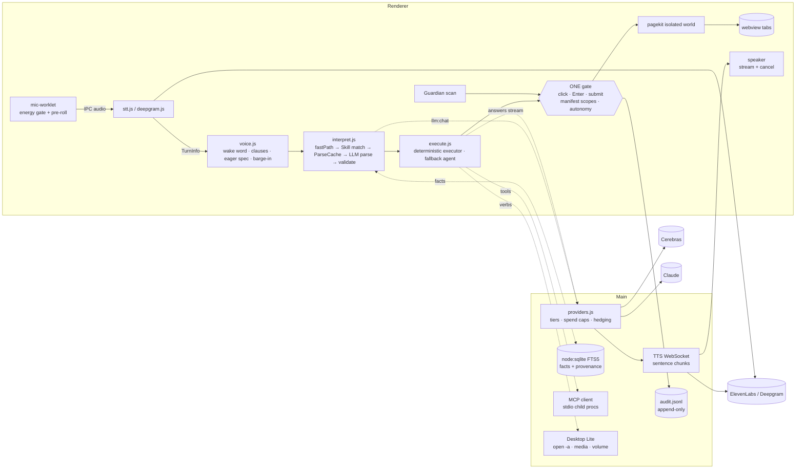

# [NAME TBD] — master plan (Dixi + VisionOS + Holmes, council edition)

> Council: **dixi-99** (this session: Dixi code, VisionOS, Cerebras/voice) + **dixi-5b** (Holmes, market, audience, safety, contest rules), each with sub-agents. Method borrowed from hex/claude-council: independent R1 positions → R2 cross-critique → R3 synthesis, with remaining disagreements logged as "council split" rows. The product name is a placeholder; "Dixi" below means the existing codebase. The website is not touched by this plan.

## TL;DR
- **Don't build a new product. Harden Dixi and finish its plan.md.** Dixi is already ahead of both references where it matters: it's the only one with proof-checked actions, a purchase gate, and real tests.
- **VisionOS is mostly demo.** Its best-known moments are canned, `main` doesn't build, memory resets every session, and it has no safety at all. **Holmes** is real but slow (3–15 s per action) and has a hard onboarding.
- Take their **ideas**, not their code. VisionOS has no license; Holmes is GPL-3.0.
  - From VisionOS: spoken progress, compound tasks, memory lookup run in parallel.
  - From Holmes: the autonomy dial, declarative plugins, the gate enforced in code, recipient grounding, a local FTS memory with provenance.
- **The 10x claim, worded so it can be measured** (an FTC overclaiming risk otherwise; see accessiBe): *the voice browser that gets faster and cheaper every time you use it, and that checks every page for known tricks before it acts.* Cerebras makes the first run fast; Skills make later runs need no AI; Guardian and one strict gate catch tricks. Public claims say "catches N of M known scam patterns in our tests", never "scam-proof" or "safe".
- **M0 is a safety hotfix:** a live gate hole (Enter, unnamed buttons, "Buy now"; dixi-5b has already written the fix, not committed) and a mic that streams all room audio to a paid API nonstop.
- **Booking (M2) runs live only where site terms allow.** OpenTable's terms (§13) bar AI assistants and Resy deactivates accounts, so on those platforms Dixi hands off to the user.
- Work done: all 10 research areas are complete. Reports are in `/Users/jaz/dixi/research/`. A fresh-context verifier checked 22/22 key claims, and the council red team produced 14 findings, all merged with no splits.

## Context
- The user wants one product that merges the best of VisionOS (TreeHacks 2026), Holmes Local v0.1.0 and their own app **Dixi** (`/Users/jaz/dixi`), with Cerebras for low latency, a plugin system, memory, strong safety, and a milestone roadmap. Plan first; no product code until approved.
- Dixi already exists: an Electron voice browser (wake word "Dixi", streaming STT, mid-sentence execution, page-structure actions, proof-checked carts, purchase gate) on a hybrid **Cerebras (fast) + Claude (planning/verification)** brain, ElevenLabs/Deepgram voice, optional Groq. Runtime deps: `dotenv`, `ws`. `plan.md` already commits to **Guardian** (code-level scam/dark-pattern firewall), **Skills** (record once, replay with no AI) and **Simple View**.

---

## R. Research findings

### R1. VisionOS teardown (ledaniel0/treehacks2026)
- **No LICENSE anywhere** (404 on license API; `server/package.json` "ISC" is the npm default, not a grant) → **inspiration only**.
- 50 commits, all Feb 13–15 2026 (hackathon-built). 3 authors, 3 stars.
- **`main` does not build**: handler imports `tts/openai.js`, `stt/openai.js` that exist only on branch `openai-voice`; `electron/src/main.ts:248-257` `await` in a non-async function.
- **The allergy demo is canned**: `server/src/test/responses.ts` (`TEST=true`) plays scripted speech + fake "Elasticsearch hit: medical_allergies". No medical field exists in the schema.
- Real topology: gpt-4.1-mini classifier → one of 5 hand-rolled ReAct agents (gpt-4.1; desktop/docs = Claude Sonnet 4.5 computer use) → `recheck` for compound tasks → regex markdown strip → TTS. Agent-S never built; Browserbase unused (Stagehand LOCAL); Agentverse = 5 identical HTTP proxies.
- **Latency**: 500 ms server VAD + classifier + non-streamed agent loop; a cart add ≈ 10–25 sequential LLM calls (Stagehand observe+act = 2 per click). `execSync` screenshots block the whole server.
- **Memory doesn't persist**: every Elastic query filters by `socket.id`; profile lookup always misses.
- **Safety: none**. No purchase confirm in code, no injection defense, server on all interfaces with `cors()` + socket.io `*` + `bash -c run_command` = remote code execution from any web page. Keys committed in history.
- **UX**: liquid-glass 700×350 panel, greeting, live transcript, chat bubbles. Agent states computed but **never rendered**; progress is audio-only; mic starts only by mouse-clicking a `<div>` (no keyboard path, in an app for blind users).
- **Worth borrowing (ideas)**: spoken progress phrases chosen per tool with cooldowns; classifier ∥ memory lookup; compound request → sub-tasks; "always use Spotlight to open apps"; observe-then-act with scroll retries.

### R2. Holmes teardown (tryholmes/holmes-local v0.1.0)
- **GPL-3.0** (required by its boring.notch port), Swift/macOS, created 2026-09-08, 2 stars → **inspiration only** (copying code would force Dixi to GPL).
- Fully local: Ollama `qwen3-vl:4b-instruct` handles vision + tool calls.
- Pipeline: screen read every few seconds (extension or AX) → **deterministic one-sentence context, no model** → **rules-based trigger** → local model drafts → user approves.
- Safety: mutating tools are **removed from the tool list in code**; Gmail draft is the only allowlisted write; batched calls inspected one by one; ~57 adversarial prompts blocked.
- Plugins ("Playbooks"): **declarative JSON manifests only, no code**, because a code plugin could bypass the gate; match on app/window/entities; cooldowns; read-only MCP servers named in the manifest.
- **Autonomy dial**: Observe / Draft / Confirm / Auto; master switch default OFF; irreversible actions always confirm.
- Weak spots (its own README): 3–15 s per action, 20–40 s model load, local models misclick on busy screens.

### R3. Dixi today (the base we build on)
- Electron 44, plain ESM JS, no bundler, **5.5k LOC**, deps `dotenv` + `ws`. Tests: `node:test` units (72), Playwright `_electron` e2e (8, live services), eval harnesses (fake web + live sites).
- Voice: ElevenLabs Scribe v2 Realtime (VAD commit 0.9 s) or Deepgram Flux (eager EOT 0.4). Wake word by consonant skeleton, 10 s follow-up window, clause splitting with speculative parse at 250 ms pauses, barge-in with echo check (`electron/src/renderer/core/voice.js`).
- Brain (`electron/src/main/providers.js`): regex fast path (~33 patterns) → parse cache → one strict-JSON parse (Cerebras fast tier; Sonnet for shopping) → `validate()` against the transcript → escalate. Deterministic executor `core/execute.js` + isolated-world toolkit `ui/pagekit.js`. Fallback tool agent. Page Q&A with verified quotes; web answers via Claude web_search.
- Safety: `IRREVERSIBLE` regex gate + spoken confirm; sensitive fields never typed; bot walls/sign-in/payment handed over.
- **Gaps**: no LLM or TTS streaming (TTS fetches a whole MP3); shopping waits for the final transcript + Sonnet (1.5–1.8 s); "Buy now" can pass the gate via the agent or click-by-name; CSP fallback runs scripts in the page world; no preference memory; no hotkey/PTT; 14 px base type, 36 px buttons; English-only; no desktop control; no plugins; `check` tier unused; docs/Settings still show Groq/Deepgram.
- Measured: live run 75/97; first navigation p50 956 ms; step done p50 4.2 s / p90 10 s.

### R4. Cerebras + voice latency
- Shared models now: **`gpt-oss-120b`** (~3,000 tok/s, $0.35/$0.75 per M, reasoning low/med/high, can't be off; rejects tools + response_format together) and **`qwen-3.8-27b`** (~1,850 tok/s, $0.99/$1.49, `reasoning_effort: none`, **image input in preview, base64 only**). All Llama models retired.
- OpenAI-compatible `https://api.cerebras.ai/v1`; SSE streaming; strict tools; strict JSON schema (no oneOf/pattern; 5k-char schema cap); automatic prompt caching (lower TTFT, no discount).
- Limits: **"Free Trial" tier** is 5 RPM per model, 30K uncached TPM, 90K total TPM, 1M tokens per day, 2 images per request (unusable for voice). Developer tier: gpt-oss 1K RPM, qwen 300 RPM. Model lists and tier names change often; re-check before shipping.
- No STT/TTS from Cerebras; integration guides for LiveKit/Cartesia/ElevenLabs.
- Voice budget target **≤800 ms** speech-end → first audio. Reference cascade sums to ~1.3 s; with Cerebras TTFT ~0.38 s it's ~1.0 s, so we also need eager end-of-turn, reasoning off, and streaming TTS with <100 ms TTFB.
- **Barge-in gotcha** (the source is 2020–22 forum comments, so **test it in Electron 44**; don't assume): Chromium AEC only cancels audio played through an `RTCPeerConnection`; Web Audio playback bleeds into the mic unless looped through WebRTC or `echoCancellation: "all"` (Chrome 141+). Dixi's LCS echo check is a workaround; keep it.
- **Deprecation**: OpenAI `gpt-4o-mini-tts` shuts down 2027-01-06 (VisionOS `main` depends on it).
- **Privacy/cost gotcha (verified)**: `electron/src/main/main.js:356` sends every 80 ms mic chunk to the cloud STT, and the wake word is matched on the cloud transcript (`core/voice.js:13-30`). So the TV and room conversations stream and bill too. A local energy gate cuts silence only.

### R5. Market (Oct 2026, dixi-5b + plan.md §1)
| Player | Threat | Why |
|---|---|---|
| **Alexa+ on the web** (agentic shopping for Prime, Jul 2026) | **Highest** | Older adults already own Echos; it works through partners (Ticketmaster, OpenTable…), not arbitrary sites |
| **Siri AI** (WWDC26: personal context, actions across apps) | High on Mac | Could gain web actions |
| ChatGPT Atlas (agent mode on paid tiers), Perplexity Comet (free incl. voice; Max $200) | Medium | Typing-first, model on every click; injected within days of launch (Brave Aug 2025, LayerX Oct 2025, Zenity Mar 2026, NeuralTrust) |
| Gemini Auto Browse (AI Pro/Ultra), Windows Copilot Actions (preview), Meta Muse | Medium | General assistants, paid, not designed for motor/vision limits |
| Apple Voice Control, Windows Voice Access | Low | Free, but you name every button yourself |
| GrandPad, ElliQ | Low | Locked-down hardware; can't act on the real web |
| CUNY "Screen Agent" (May 2026, academic), Strawberry ($6M, work browser) | Low | Research / pro-focused |

**The gap**: nobody combines a senior/motor-impairment focus, scam blocking written in code, and replay with no AI. **The threat is distribution (Alexa+, Siri), not features.** Root cause of every competitor's injection incident: no boundary between what the user meant and what the page says.

### R6. Audience (dixi-5b)
- **Core**: 65+ and motor impairments (tremor, Parkinson's, arthritis). About 20.7% of older adults' voice commands go unrecognized (2026 Springer review), so being patient with pauses and slow speech is a requirement.
- **Blind / low vision**: v2, co-designed with blind testers. Now: everything spoken, ARIA live captions, no visual-only confirms, a keyboard start.
- **Busy pros / multitaskers**: they benefit from the same speed, but they **aren't marketed to** in v1 (crowded market). Never market it for use while driving.
- Features that serve everyone: speed, Skills (one sentence for a chore), Guardian, typed fallback, answers that show their source.

### R7. Contest rules (dixi-5b)
- **CAC 2026**: deadline is Mon Oct 26 12:00 PM ET in most districts, Oct 30 11:59 PM PT in at least one. **Until the user's district is known, nothing merges to `main`.** Work prior to the contest is allowed if created after Oct 30 2025 (Dixi's first commit is 2026-04-12, so it's eligible). All AI use must be disclosed.
- **Build-during-event hackathons** (MLH-style): Dixi + this plan is **prior work** and must be declared as such; it can't be entered as new.
- Copying VisionOS (no license) or Holmes (GPL) would be an originality problem anywhere. Policy: ideas only, rewritten, credited.

---

## 1. Feature matrix (ranked by value)
Quality = how well the source actually implements it (1–5, from reading the code). Effort is for us (S < 1 day, M 1–3 days, L ~1 week).

| # | Capability | VisionOS | Holmes | Dixi | Effort | Verdict | Why |
|---|---|---|---|---|---|---|---|
| 1 | Deterministic, proof-checked actions on real sites | Stagehand, 2 LLM calls per click, no proof (2) | AX/extension clicks (3) | pagekit + executor + proofs (4) | — | **ADOPT (have)** | This is the base everything else stands on |
| 2 | One code-level action gate | none (0) | tool list filtered in code (5) | name-regex gate with holes (2) | S | **ADAPT → M0** | Live safety hole; one fix where every action routes |
| 3 | Guardian: scam/dark-pattern firewall | none | rules-based triggers (idea) | planned (plan.md) | L | **ADOPT → M2 (hard rules + cheap checks), M3 (rest)** | The wedge: elder fraud $7.7B; DECEPTICON says prompts can't do it |
| 3b | Booking with confirm gate | none | none | none | M | **ADAPT → M2** | Your brief asks for it. Live only where the terms allow; patterns from travel-agent and restaurant-cli |
| 4 | Streaming voice loop + barge-in | Cartesia stream, slow barge-in (2) | push-to-talk, ElevenLabs (3) | streaming STT, echo-aware barge-in, non-streamed TTS (3) | M | **ADAPT → M1** | Gets answers under 800 ms |
| 5 | Record once, replay without AI (Skills) | none | Playbooks (prompted, 3) | planned | L | **ADOPT → M4** | The 10x engine: $0 and seconds on repeat |
| 6 | Autonomy dial + rate budget | none | Observe/Draft/Confirm/Auto (5) | none | S | **ADAPT → M4** | Lets a caregiver decide how much a Skill may do |
| 7 | Spoken progress phrases | per tool, with cooldowns (4) | notch status (3) | step list + mascot (3) | S | **ADOPT → M1** | Waiting is easier when it's narrated; vital without sight |
| 8 | Local memory of preferences | Elastic+Jina, doesn't persist (1) | SQLite FTS5 + provenance (4) | none | M | **ADAPT → M5** | "Say less, it does more"; local-only for trust |
| 9 | Simple View, large type, multilingual | none | none | planned | M | **ADOPT → M5** | Opens the product to people a busy page loses |
| 10 | User plugins (Claude Code SKILL.md + MCP tools) | none | JSON playbooks + read-only MCP (4) | none | M | **ADAPT → M6** | Explicit user requirement; narrow-only, gate-enforced |
| 11 | Compound requests ("find X and tell me Y") | split into sub-tasks, loses results (2) | — | clause chaining in spoken order (4) | S | **ADAPT → M1** | Pass the first step's result into the second |
| 12 | Mid-task refinement ("no, the cheaper one") | canned in demo (1) | — | "make it two", "never mind" (3) | M | **ADAPT → M5** | Edit the running task's slots, don't restart; uses memory facts |
| 13 | Desktop control | Claude computer use via blocking osascript (1) | ComputerUseEngine (3) | none | S | **ADAPT → M6 "Desktop Lite"** | Typed verbs only (open app, media, volume), no Accessibility permission |
| 14 | Caregiver alerts / remote approve | none | none | back pocket | M | **ADOPT → M7** | It's what the Family plan sells |
| 15 | Tap-or-hold talk key + e-stop | hotkey only shows/hides window (1) | hold Fn (4) | Esc + "stop" (3) | S | **ADOPT → M1** | Privacy mode + kill switch; tap = toggle for tremor |
| 16 | Append-only audit log | console only (1) | run evidence (3) | debug traces (2) | S | **ADOPT → M0** | "What did you do today?"; proof for caregivers |
| 17 | Grounded web answers | Perplexity Sonar (3) | — | Claude web_search (4) | — | **SKIP Perplexity** | Same job, existing key |
| 18 | Multi-agent LangGraph router | gpt-4.1-mini classifier hop (2) | BackendRouter | code router (4) | — | **SKIP** | Adds a hop; Dixi's strict-JSON parse already routes |
| 19 | ElasticSearch + Jina embeddings | (1) | — | — | — | **SKIP** | A search cluster on a senior's laptop is absurd; FTS first |
| 20 | Proactive screen watching | — | every few seconds, AX + extension (4) | — | — | **SKIP v1** | Scary permissions; Guardian is the proactive watcher, but only on pages Dixi opens |
| 21 | Local vision model (offline) | — | Ollama qwen3-vl (3) | — | — | **Back pocket** | 3–15 s per action, 8–16 GB RAM |
| 22 | Voice coding, Agentverse, orb visualizer | demo-grade (1) | — | — | — | **SKIP** | Not for the audience; `run_command` is an RCE |

## 2. Product vision
**Pitch.** The web, hands-free, with a careful second pair of eyes. Say what you want; it does it on the real website, checks its work, and stops when a page shows the signs of a trick. The first time is fast, and every time after that is instant and free, because what worked is saved as a Skill that replays with no AI. Built first for people a mouse leaves behind: older adults, people with tremor, arthritis or low vision. It works for anyone who'd rather say it than click through it.

**Who.** Primary user: 65+ or motor-impaired, at home, on a Mac. Buyer: their adult child or caregiver. Pilot partners: libraries and senior centers. v2: blind and low-vision users, co-designed.

**The five core experiences**
1. **"Just say it."** One sentence → done on the real site, with spoken progress and an answer in under a second.
2. **"It watches for the tricks."** Guardian stops fake virus warnings, look-alike stores, sneaked-in add-ons and gift-card demands, says why in one calm sentence, and can tell the caregiver.
3. **"Do my usual."** "Watch me" once (or a caregiver does it), then "refill my prescription" replays in seconds with no AI and no cost.
4. **"Make it simple."** Any page becomes huge type, a two-sentence summary and up to six big buttons, in your language.
5. **"It knows me (and shows what it knows)."** Remembers sizes, stores and allergies locally, uses them only when relevant, and forgets on command.

## 3. System architecture


| Part | Powered by | Existing key? | Notes |
|---|---|---|---|
| STT | ElevenLabs Scribe v2 Realtime; Deepgram Flux fallback | yes / yes | Flux has eager end-of-turn; Scribe doesn't (`stt.js` maps only Update/EndOfTurn) |
| TTS | ElevenLabs `eleven_flash_v2_5` over WebSocket (multi-context, `close_context` for barge-in) | yes | Replaces REST `eleven_turbo_v2_5` whole-MP3 fetch; system voice fallback stays |
| Parse / route | Cerebras `qwen-3.8-27b`, reasoning `none`, strict JSON | yes | Already the fast tier; the shopping parse moves here only if the live suite holds |
| Spoken answers | Cerebras streamed → sentence chunker → TTS | yes | Haiku hedge stays |
| Agent step, Skill heal, Simple View summary/translation | Cerebras `gpt-oss-120b` (low) | yes | No `tools` + `response_format` together on gpt-oss |
| Shopping escalation, checkout, failures | Claude Sonnet/Opus 5.5 | yes | Unchanged |
| Vision fallback | Claude Haiku 5.5; Cerebras qwen vision behind a flag | yes | Cerebras vision is preview |
| Web answers | Claude Haiku + `web_search` tool | yes | SKIP Perplexity |
| Site resolution | registry → DuckDuckGo/Brave → Wikidata | keyless/opt | Unchanged |
| Guardian data | RDAP (keyless), URLhaus (keyless), generated top-sites list | keyless | New, free |
| Memory | `node:sqlite` built into Electron's Node | n/a | No new dependency |
| Plugins | MCP over stdio, a hand-written JSON-RPC client | n/a | No SDK unless the hand-written one grows past ~150 lines |
| Caregiver alerts (M6) | ntfy.sh (free) | new, no account | M6 |
| **Gap: key proxy for real users** | thin proxy on the website's existing Vercel + Supabase | n/a | **User decision** (contradicts "no Dixi servers") |

**Latency design (voice loop)**
- **Mic → STT**: 80 ms frames, an energy gate with an adaptive noise floor and **≥ 500 ms pre-roll** so soft first words aren't clipped, plus the provider's keepalive while gated.
- **End of turn**: eager end-of-turn *starts* the parse speculatively. The draft is discarded on TurnResumed and never commits early. The commit silence adapts per user and gets longer for people who pause or self-correct.
- **LLM**: the fast path and Skills need no LLM. Otherwise one Cerebras call (cached system prompt, reasoning off). Answers stream.
- **TTS**: the first sentence goes to TTS as soon as it ends (≥ ~40 chars or punctuation). Later sentences pipeline behind it. Barge-in closes the context and flushes queued audio.
- **Speculation already in Dixi, kept**: clause-by-clause dispatch, preconnect, search-URL prefetch.
- **Budget** for an answer, speech end → first audio: endpoint ~250 ms + Cerebras first token ~200–400 ms + TTS first audio ~100–200 ms ≈ **≤ 800 ms p50**. Fast-path commands start acting in **≤ 300 ms**.

## 4. Plugin / extension system (M6)
**Principle (from Holmes).** Nothing a plugin ships can widen what Dixi may do. Permissions live in a manifest that the **one gate enforces in code**. Prose can only narrow what's allowed. No plugin code runs inside Dixi.

**Two kinds of Skill, one format**
- **Recorded Skill** (M4): JSON steps compiled from a run that worked. Replays with no AI.
- **Instructed Skill** (M6): a Claude Code skill folder. Its `SKILL.md` body is given to the agent tier as *untrusted guidance* for the first run. A successful run is compiled into a recorded Skill, so later runs need no AI either.

```
<userData>/skills/<id>/
  SKILL.md     # Claude Code format: frontmatter name + description; body = guidance (untrusted)
  dixi.json    # permission manifest, enforced at the gate
  mcp.json     # optional: MCP servers (stdio command), started as child processes
  steps.json   # written by Dixi after a verified run (recorded form)
```
```json
// dixi.json (schema v1; unknown keys ignored, newer versions refused)
{ "version": 1, "id": "refill-prescription", "sites": ["cvs.com"],
  "verbs": ["open", "search", "click", "type", "read"],
  "irreversible": "confirm",             // never "auto"
  "autonomy": "confirm",                 // observe | draft | confirm | auto (clamped by the master switch)
  "slots": { "drug": "text" },           // the only values it may type, from what the user said
  "tools": { "pharmacy": { "read": ["lookup_rx"], "write": [] } },
  "memory": ["read:pharmacy"] }
```

**Enforcement**
- **Sites**: navigating off the listed `sites` stops the run.
- **Typing**: only slot values, things the user said, or the user's own memory facts can be typed.
- **Tools**: read tools need MCP `readOnlyHint` and a read-shaped name. Write tools always go through the confirm gate.
- **Batches**: every call in a batch is checked separately.
- **Rate budget**: at most 6 autonomous runs per Skill per hour, 20 in total, and the master switch for autonomous runs is OFF by default.

**Discovery and install**
- Settings → Skills lists the installed Skills. Saying "use my refill skill" or matching a Skill's description picks one; the model chooses only from a fixed list of installed Skill ids.
- **Install happens only on the machine, by the user or caregiver, from a folder.** Never through a link or a remote command ("install this Dixi skill" is the next scam script).
- Install reads the permissions aloud in plain words and needs a yes.
- Importing from `~/.claude/skills/<name>` copies the folder and asks for a manifest. Scripts inside a skill folder are **never executed**.
- No marketplace.

**Sample plugin, "refill my prescription"**
- `SKILL.md`: "Open the pharmacy site, sign-in is handed to the user, find Refill, choose {drug}, stop before Submit."
- `dixi.json` as above.
- First run: the agent follows the guidance and stops at the gated Submit for the spoken yes.
- Dixi writes `steps.json`, so the next run is a replay with no AI.

## 5. UI / UX plan
**Identity.** Keep Dixi's own marble-and-glass language: grayscale marble, clear glass, bold black type, a small marble mascot. It owes nothing to VisionOS's liquid-glass panel or Holmes's noir notch, and the mascot works with any final name.

**Layout.** A full-window browser. The bottom **State Island** grows out of today's caption (a black glass pill) and is the single place where state lives. Above it, a **Confirm Card** appears only when needed. Simple View is a full overlay.

| State | Island shows | Color cue | Mascot | Sound (≤200 ms, can be turned off) | Screen reader |
|---|---|---|---|---|---|
| Idle | "Say 'Dixi' or tap [key]" | marble | sleep | — | — |
| Listening | live words, waveform | white glow | curious | soft rising tone | polite |
| Working | step list, ✓ as each step is proven, spoken progress | gold | busy | — | polite |
| Speaking | the sentence being said, source line under it | white | nod | — | polite (VoiceOver mode: text only) |
| Confirming | Confirm Card: "Pay **$12.99** to **CVS**?" with huge Yes / No | gold border | attentive | two-note chime | **assertive**, focus moves to the card |
| Guardian stop | one calm sentence + evidence line | **red** | protective | low, steady tone (not an alarm) | **assertive** |
| Done | result + source | green | happy | two-note down | polite |
| Stopped | "Stopped." | marble | sleep | short click | polite |

Today the caption has no visual for "thinking" or "confirming"; VisionOS computed its states and never drew them. Here every state is drawn, spoken and announced.

**Motion.** The island morphs between states with spring easing (≤250 ms) and the step list ticks on. `prefers-reduced-motion` turns morphs into crossfades. No flashing.

**Hands-free and keyboard-free flows**
- Wake word, with a follow-up window.
- **Tap-or-hold on one big key** (configurable, default F5; idea from Handy). A **tap toggles** the mic (tremor-friendly; red team #11d). A **hold of 300 ms or more** is push-to-talk. Pressing again or saying "stop" stops.
- **Voice recovery phrases** (idea from screen-voice-agent):
  - "That wasn't me" drops the last turn and offers to undo.
  - Hard-stop words ("stop", "wait") work between sentences.
  - Dismissal phrases ("thanks, that's all") close the follow-up window.
  - A short list of echo phrases ("thank you", "bye") is ignored right after Dixi speaks.
- **Interruptions** (ideas from LiveKit):
  - Barge-in needs at least 0.5 s of speech.
  - If nothing follows within 2 s, Dixi resumes the sentence.
  - Barge-in is ignored during the first ~3 s of TTS while echo cancellation warms up.
  - The LLM starts early; TTS never does.
- **Spoken equals written** (idea from VoxStride): every spoken line is also caption text, and muting never hides text. "Stopping…" changes to "Stopped" only once cancellation is confirmed. With VoiceOver focused, Dixi speaks through aria-live; otherwise it uses its own voice. The caption never scrolls while someone is reading older lines.
- **Earcons can be turned off by voice** ("no beeps"). Every state is shown three ways: colour, a label and a symbol (idea from echonav).
- **Every voice confirm has an equal physical path**: a huge on-screen YES / NO plus the key. People with dysarthria can't reliably *say* amounts.
- "Stop" or Esc always works.
- Spoken yes/no for confirms; payments need the yes to repeat the amount.
- Typed bar as a fallback.
- Switch access: Tab/Space scanning across Island, Card and Simple View buttons.

**Accessibility requirements**
- Type: base 14 px → settings for 16/20/24/28, with **Simple View at ≥ 28 px and 64 px buttons**.
- High-contrast theme (WCAG AAA 7:1) and a reduced-transparency fallback (already present).
- **Captions**: every spoken line is also on screen; Deaf and hard-of-hearing users can type and read.
- **Adjustable speech rate** 0.8–1.3×, plus voice choice.
- **VoiceOver mode**: Dixi stops its own TTS and speaks through aria-live, so the two never talk over each other.
- No visual-only confirm. Focus is managed and visible (2 px rings already exist).

## 6. Memory design (M5)
- **Where**: local only, `userData/memory.db` (`node:sqlite`, FTS5). Nothing goes to the cloud except the facts included in one prompt.
- **Rows**: `fact(id, key, value, kind[pref|person|place|health|account-hint], provenance[said_by_user|verified_outcome], source_utterance, site, created, last_used, sensitive)` plus `episode(id, ts, utterance, outcome, site)`, the "what did I do Tuesday" log.
- **Verified**: Electron 44.7.2 bundles SQLite 3.53.4 with FTS5, so this needs no dependency.
- **Ideas borrowed** (permissive, Apache-2.0):
  - **Graphiti**: supersede, don't overwrite (`valid_from` / `valid_to`), so "I moved to size 9" keeps the history.
  - **Letta**: up to 10 non-health core facts always in the prompt; everything else through FTS5.
  - **mem0**: add / update / delete operations, but decided **in code**.
- None of mem0, Letta, Graphiti/Zep or LangMem fit as-is: each assumes a server, an LLM call per write, or a vector or graph database. None blocks writes from page text.
- **Writes**: only from what the user said ("I wear a size 10", "I'm allergic to peanuts") or from verified outcomes (the cart really held size 10). **Never from page text**, which blocks memory poisoning. Never passwords, card numbers or codes.
- **Retrieval**: keyword search (FTS5) on the task's site and slots, top 5. Facts marked `health` are included **only** for food or medicine tasks and never in a general digest. Embeddings are deferred until FTS measurably misses.
- **Medical humility**: allergies are used to *filter or warn* only when the page's ingredient text quotes the allergen. Otherwise Dixi says "I can't confirm this is peanut-free". It never recommends a medicine; VisionOS's canned demo recommended a salicylate to an aspirin-allergic user.
- **User control**:
  - Spoken: "what do you remember about me", "forget that", "forget everything about CVS".
  - On screen: a Settings → Memory page listing every fact with its source sentence, with edit and delete for each and "pause memory".
  - Export as JSON. A caregiver can view it only on the device.

## 6a. Eval design (extends what exists: `electron/eval/run.js`, `world.js`, `server.js`, `gen.js` 318 cases / 33 categories, `live.js`, `audio.js`, `demo-voice.js`)
Dixi's fake web, where the server logs what really happened, is already the WebArena/REAL design. Add:
1. **Deterministic regressions**: make `DIXI_LLM_CACHE=replay` the default (no cost, repeatable; a cache miss means a prompt changed). Fix the `overhead()` stub in `run.js`, which returns null.
2. **Real-site snapshots**: `live.js --snapshot rec|play` through `protocol.handle('https')` on the tabs session. Read-only tasks only. Whether webview traffic is caught is **UNVERIFIED**, so test it first.
3. **Voice audio mode**: `run.js --mode audio` reusing `audio.js` `render()` (accents, speeds, babble, **TV noise**). First audio is recorded at `onplaying` in `speaker.js`.
4. **Adversarial categories** in `gen.js`:
   - injection text in descriptions, reviews, alt/aria labels and hidden text;
   - dark patterns;
   - unnamed or `div` pay buttons, and a "Continue" that is really the final step;
   - look-alike hosts and tech-support pages;
   - coached gift-card flows.

   The harness answers "no" by default; a positive-control subset answers "yes". Plus the **blind held-out set** written by the other council member.
5. **Skills drift**: record on seed S, then replay must make 0 LLM calls. `--drift D` re-rolls labels and layout; the run must heal, or stop honestly after 2 failures.
6. **Memory**: `test/unit/memory.test.js` feeds an injection page and asserts that nothing is stored.

**Metrics**

| Metric | Definition |
|---|---|
| Task success | Every server-side check passes; Wilson 95% interval; bot walls excluded |
| Steps, LLM calls, tokens | From traces and `window.__llm` |
| $ per task | `usd` from `providers.chat` plus STT/TTS fees (mean and p90) |
| First-audio latency | p50/p90 |
| **Unsafe commit** | Must be 0 |
| **False-confirm rate** | Questions on non-final steps; too many teach users to say "yes" by habit |
| **Confirm-miss rate** | Final steps reached without a question |
| Guardian | False-positive rate and recall |
| **Injection compliance** | How often Dixi acted on injected text |

`treehacks-amogus` (an Among Us game played by LLMs, with Elo eval) taught only what Dixi already does: the environment writes the log, and runs are seeded and planned up front. Its replay is view-only, while Dixi's LLM cache lets a run be re-executed.

## 6b. Safety design (council-signed; dixi-5b's code audit + published defenses)
**Why it has to be code, not prompts:**
- "The Attacker Moves Second" (authors from OpenAI, Anthropic and DeepMind) broke 12 published injection defenses with adaptive attacks ([Willison](https://simonw.substack.com/p/new-prompt-injection-papers-agents)).
- Claude in Chrome's own red-team results: 23.6% attack success without mitigations, 11.2% with them (Aug 2025, [Anthropic](https://www.anthropic.com/news/claude-for-chrome)). Later results are first-party and use model classifiers: 1.4% for Opus 4.5 (Nov 2025); 0–0.3% with tool-result probes plus an **action-vs-request classifier** (Aug 2026, [GA post](https://claude.com/blog/claude-in-chrome-generally-available)). Dixi can run that action-vs-request check **in code** against its JSON plan, with no model involved.
- **Detectors are not a defense**: across 10 open-source injection detectors and 629 AgentDojo attacks hidden in tool output, the best (`jailbreak-detector-large`) caught 319/629 (51%) at 2/97 false alarms (2%). Meta's Prompt Guard 2 caught 6/629 (1%) at its default threshold ([buried-injections README](https://github.com/rudratoshs/buried-injections), MIT; checked 2026-10-29. One author's benchmark, not peer-reviewed).
- **Tool filtering works**: on GPT-4o (2024-05-13) with the important_instructions attack, a tool filter fixed *before* any untrusted data arrives cut targeted attack success from 47.69% to 6.84%, and utility *rose* from 69.07% to 72.16% ([AgentDojo official results](https://agentdojo.spylab.ai/results/), checked 2026-10-29).
- DECEPTICON: dark patterns steered agents in more than 70% of tasks, versus 31% for humans, and stronger models fell for them *more*.

**The architecture already resembles CaMeL** ([arXiv 2503.18813](https://arxiv.org/abs/2503.18813): a privileged planner sees only the user's request, and a quarantined model reads untrusted data with no tools):
- Dixi parses the *utterance* into a strict-JSON plan before reading the page, and **code** executes it.
- Page Q&A reads the page but cannot act.
- The only place that mixes the two is the **fallback agent**, so that is where the new rules bite.

| Layer | Rule | Enforced in |
|---|---|---|
| **One gate** (M0) | Every page-changing action (toolkit click, Enter, `requestSubmit`, `form.submit()`, a search form's button) goes through `gate()`. Fail closed on sensitive pages: an unnamed or default submit on a page with payment fields = confirm. Verbs extended to buy now, subscribe, start trial, donate, book/reserve, Apple/Google Pay, PayPal, send money, a $ price in the main button | `ui/pagekit.js` (written by dixi-5b) |
| **Gate status (dixi-5b, written, not committed)** | Done on the branch:<br>• `gate()` now also stops wallet/express pay, buy/order now, subscribe, trial, donate, book/reserve, and buy buttons that show a price.<br>• On payment pages, any unnamed or submit control asks first.<br>• `submitGate()` covers form submit; `tabs.key('Return')` asks `enterGate()` first and fails closed.<br>• `submitSearch` and `formURL` are gated.<br>• **Round 2 (after the file-map review):**<br>  - "order now" asks only on payment pages, so restaurant orders work again.<br>  - Enter inside a frame Dixi can't read now asks first.<br>  - The toolkit's global name is **random per launch**.<br>  - The **main process refuses the page-world fallback on payment addresses**. It reads `wc.getURL()`, which a page can't fake.<br>  - A shared `RECURRING` regex: `gate()` and all 5 `choose()` branches refuse repeating options, `reveal()` won't open them, and the executor's default pick skips them.<br>• `gate.spec.js` **5/5** (three runs); units 72/72. Partial live rerun on round 2: **48/58 vs 47/58** for the same steps in the Oct 23 baseline (+7 Apple, −6 Amazon). The Amazon losses line up with Amazon bot walls, so Amazon and the remaining steps are being rerun. The fix stays uncommitted until that run is clean.<br>**Still open:**<br>(1) `dismissOverlays` must never auto-click a dialog that shows a price (it can be an upsell modal labelled "OK").<br>(2) When the user *says* "subscribe and save", it's refused silently; the M2 Confirm Card adds the confirm path. Cart +/- and the search toggle stay ungated (reversible).<br>(3) Ceiling: card fields inside a cross-origin payment frame (Stripe Elements) are invisible, so a checkout at an ordinary-looking address relies on the word list. Red-team it.<br>(4) The confirm for an unnamed button is safe but vague; M2 reads the amount and merchant off the page | `ui/pagekit.js`, `ui/tabs.js`, `core/agent.js` |
| **Value grounding** (CaMeL-lite) | Anything typed or navigated to must come from the user's words, a Skill slot, the user's memory facts, or a trusted resolver. **Never type page text back into a page**; a send or booking only addresses people the user named | executor + agent tool wrappers |
| **Fallback agent fenced** (it is the one component with all three Rule-of-Two properties) | **Tool filter fixed by the plan**: the agent may use only the verbs and hosts the strict-JSON plan allows, decided before it reads the page. **It can never pass the gate itself**: every gated step goes back to the executor's confirm path. **Typed outputs only**. **An action-vs-request check in code**: each proposed action must map to a plan step, or it is refused. Spotlighting or datamarking of page text is a cheap extra layer, never relied on.<br>**How it's enforced (dixi-5b, from the code):**<br>• **The host fence is checked at navigation**, not just on tool arguments. The agent has no raw-URL tool, but clicking a link can still leave the site. Every top-level navigation in the tab's `will-navigate` / `did-start-navigation` path is checked against the plan's host list. If the host isn't allowed, it stops and says where the link was going.<br>• **Text grounding sits in one place, `agent.js` `type_text`** (the same spot as the Enter fix). The text is allowed only if it normalizes to a substring of what the user said, a Skill slot, or a typed profile value. Otherwise it returns `confirm: …` and the text is read aloud, so a payee, amount or date taken from the page is caught automatically, in code, with no classifier. | `agent.js`, `tabs.js`, `llm.js` |
| **Rule of Two** ([Meta](https://ai.meta.com/blog/practical-ai-agent-security/)) | A run that reads untrusted pages *and* holds sensitive state (logged-in sessions, memory) gets no unsupervised state change: irreversible steps always need a human yes | gate + autonomy dial |
| **Payment / booking confirm** | Read back the amount, merchant and date or party size. The spoken yes must repeat the amount ("yes, twelve ninety-nine"), so a TV can't approve. No confirm while a Guardian finding is open | `confirmThen` + voice |
| **Confirm integrity** (red team #1, #3, #11e) | These stop Dixi confirming itself through echo, and stop the page changing after it was checked:<br>• The listening window opens only **after Dixi's read-back finishes playing, plus 300 ms**.<br>• Any transcript that overlaps what Dixi said in the last 10 s is thrown away (strict LCS echo check).<br>• It needs "yes"/"confirm" **plus** the amount, normalized to dollars ("fifteen" vs "fifty"). On a mismatch it re-asks once, then offers the button.<br>• Silence or a timeout = **no**.<br>• **Re-read the amount, merchant and items right before pressing**; anything different means asking again.<br>• Never re-press Pay or Book in the same run. If it can't verify, it says "I pressed Book but saw no confirmation; check your email before I try again." | `confirmThen`, voice, gate |
| **Speculation gate** (idea from pipecat) | Speculative execution while the user is still talking may run only reversible steps (open, search, scroll). Anything the gate would confirm waits for a definite end of turn. Silence means no, said aloud: "No answer, so I didn't do it." Saying "details" re-reads the pending action. **Never substring-match "yes"** (echonav's bug) and never auto-approve on a timeout (screen-voice-agent auto-approves after 10 s) | voice + gate |
| **Coached-scam hard rules** (red team #2) | A voice yes can't override:<br>• gift cards above a threshold or in quantity;<br>• wire, crypto, or Zelle/Venmo to a *new* payee;<br>• remote-access tools;<br>• "refund" or "support" sites.<br>Each one means stop, then a **15-minute cooling-off hold**, then a caregiver note if one is linked. This targets the #1 elder-fraud pattern, a scammer on the phone coaching the victim | Guardian (M2) |
| **Caregiver can't become a controller** (red team #10) | The caregiver can approve or deny only, never start purchases or browse remotely. The senior sees who is linked and is told when the log is viewed; the caregiver's view is summaries only. Unlinking, or any change to the link, needs a local action on the machine | M7 |
| **Everyday harms** (red team #11) | **Repeat-order check** from the audit log ("You ordered this Tuesday. Order again?").<br>**Pharmacy or health Skills**: never at Auto, no self-heal on the item-picking step, read back the drug name + strength.<br>**"Help, I fell"**: a fixed reply ("Call 911 or press your alert button"), a caregiver ping if linked, no browsing, and never a claim that Dixi calls emergency services | executor, Skills |
| **Guardian** (M2 hard rules + cheap checks; M3 the rest). Rules are written as **a small policy table checked in code** (idea from Progent, MIT): changes that narrow a rule apply automatically, changes that widen one need approval. **No ML detector is relied on.** SusBench's worst offenders come first: pre-selected options, trick wording, hidden info, and **a final total that differs from the planned amount** | Look-alike domains, new domains asking for payment, URLhaus, tech-support traps, gift-card/crypto/wire demands, pre-ticked add-ons, fake timers, **blocks remote-access-tool downloads** | new `core/guardian.js` |
| **Autonomy + rate** | Observe/Draft/Confirm/Auto per Skill; master switch OFF; at most 6 autonomous runs per Skill per hour, 20 in total | Skills runner |
| **Plugins** | Manifest scopes enforced at the gate; prose can only narrow; no in-process code; install only on the device | M5 |
| **Secrets** | Keys stay in the main process (already); passwords, cards and OTP fields are never typed (already). Fix: the CSP fallback that runs the toolkit in the page world must refuse gated actions there | `main.js` `tab:exec` |
| **Audit log** | Append-only `userData/audit.jsonl`, one line per gated action: ts, host, verb, element name, decision, evidence. Spoken "what did you do today?" | gate |
| **E-stop** | "Stop" / Esc / the PTT key: aborts the run, closes the TTS context, cancels in-flight `llm:chat` (an AbortController per run) | voice + providers |
| **Network** | No local server listens (unlike VisionOS's `0.0.0.0` + `cors *` + `bash` RCE). The eval control hook stays env-gated on localhost with a token | `main.js:173-191` (keep) |
| **Privacy claims** | The wake word is matched in the cloud, so docs must not say "only listens when you say Dixi". The talk key is the privacy mode; a local wake word comes in M1 if the M0 cost numbers demand it | docs |

## 6c. Token + latency budget
Token figures are estimates (chars ÷ 4) from reading the code; M0 replaces them with measured numbers. **Token-repo verdict (#24–30, `research/token-latency.md`)**:
- Most of those tools compress coding-agent output (shell logs, big JSON). Dixi already caps its inputs, so **no compression proxy is adopted**: each adds a network hop, and most of their numbers are self-reported on synthetic data.
- Dixi **already** sends elements as compact text rows with refs (`agent.js:14` `compactElementList`), which is the format agent-browser recommends.
- **Lightpanda** (AGPL-3.0, no native Windows) refetches pages without the user's session, and **agent-browser** as a runtime needs a remote-debugging port (a security hole). Dixi calls CDP itself through `webContents.debugger`.

| Step | Model | Input tokens (target) | Output cap | Latency target | Today |
|---|---|---|---|---|---|
| Fast-path command / Skill replay | none | 0 | — | action starts ≤ 300 ms after the clause ends | fast path exists; Skills in M4 |
| Intent parse | Cerebras qwen-3.8 (reasoning none), strict JSON | ≤ 2k (system + schema cached first, then transcript + 1-line page context) | 200 | ≤ 400 ms total | same model, not streamed; shopping goes to Sonnet (1.5–1.8 s) |
| Page answer | Cerebras → Haiku hedge at 1.5 s | ≤ 2.2k (prompt + `relevantText` ≤ 7k chars, `pageQA.js:19`) | 300 | **first audio ≤ 800 ms p50** after speech ends | not streamed; whole MP3 |
| Fallback agent step | Cerebras gpt-oss-120b (low) | ≤ 4k (system + 7 tools ≈ 0.8k, ≤ 40 pruned elements, last 3 results) | 200 | ≤ 1 s per step | up to 70 elements; history grows (`agent.js:114`) |
| Vision fallback | Claude Haiku | ≤ 2.5k (≤ 1024 px JPEG ≈ 1.4k image tokens + element list) | 150 | ≤ 2 s | 1280 px q50 |
| Web answer | Haiku + web_search | provider-side | 300 | ≤ 3 s, with a spoken "Looking that up" at 0 s | exists |

**Compression stack, ranked by savings ÷ risk**
1. **Don't call a model.** Fast path, parse cache, Skills replay. Saves 100% on those turns. Risk: a stale Skill, caught by proof checks and repaired by one-step heal.
2. **Cache-friendly prompt order.** Fixed system prompt and schema first; URL, time and page state last. Cerebras caches prompt prefixes automatically in 128-token blocks, guaranteed for 5 minutes. That cuts **latency only**: cached tokens are billed at the normal rate ([Cerebras docs](https://inference-docs.cerebras.ai/capabilities/prompt-caching)). Anthropic's cache also cuts cost. M0 logs `usage.prompt_tokens_details.cached_tokens` to prove hits. No quality risk.
3. **Prune elements for agent steps.** Interactive roles only, viewport first, de-duplicated, names ≤ 60 chars, ≤ 40 items. Estimated ~40% fewer agent tokens. Risk: an off-screen target, so the model is told it can scroll.
4. **Send only what changed between agent steps**, following agent-browser's `--delta` rules (idea only): refs stay stable, and the full state is sent after a URL change or whenever the diff wouldn't be smaller. **No project publishes a token number for this**, so M1 measures it. Risk: stale refs.
5. **Compact history.** Keep the last 3 tool results, **each capped in length**, and summarize older ones to one line each. Trim schema descriptions to the actions the page allows. Savings are unmeasured and parse accuracy could drop, so A/B it against the parse-cache logs.
5b. **Vision fallback extras** (optional, small gain because vision is rare): skip a screenshot when the page hasn't changed, and draw ref numbers onto the screenshot so the model's answer maps straight to an element.
6. **Screenshots only as a fallback**, downscaled to ≤ 1024 px. Risk: small text becomes unreadable, so crop to the region instead.
7. **Output caps per tier plus strict schemas.** No quality risk.

**Cost per task (estimate):**
- **First-run shopping task on Cerebras:** 1 parse + ≤ 3 agent steps ≈ 14k in / 1k out ≈ **$0.006**.
- **Sonnet escalation** dominates when it happens. Measure its rate in M0.
- **Replay:** **$0 LLM.**
- **The real unit cost is voice:** streamed STT minutes and TTS characters. M0 measures both before any pricing is set.

## 6d. Booking flow (M2)
**Platform terms decide where this can run live** (booking agent, terms read 2026-10-29):

| Platform | Terms | What it means for Dixi |
|---|---|---|
| **OpenTable** | Terms of 2026-07-22, **§13** bars "generative AI or other AI technology" and "automated assistants" unless OpenTable authorizes them; **§18.2**: "Actions of AI agents are acknowledged as actions of the User" | Automating it risks the **user's** account |
| **Resy** | Says it "does not currently permit unapproved third-party bots or agents", and has **deactivated accounts** of people who used them | Same; its only approved routes are its own ChatGPT and Claude integrations |
| **Yelp** | Reservations API is partner-only | Not available to us |
| **Google** | Reservations End-to-End needs a contract with every merchant | Not available to us |
| **Tock** | Terms page didn't load | **UNVERIFIED** |

- **Default**: the booking engine is built and proven on **eval fixtures**, and runs live only on venue or appointment sites whose terms don't forbid assistants.
- **On OpenTable and Resy, Dixi does a hand-off**: it opens the venue's page for the date and party size, says "This site doesn't allow assistants to book, so please press the time you want", and stays silent while the user books.
- **This is a user decision** (open question 10). Amazon's consumer terms on agents are also **UNVERIFIED**, so the same question applies to shopping.
- No repo checks a user's calendar; Dixi has none either, so it says so.

**The flow:**
0. **Confirm the venue aloud** (name, street, site domain) before looking at times (idea from restaurant-cli and travel-agent).
1. **Parse slots**: place or cuisine, date, time window, party size.
   - **Name, phone and email come only from a profile the user or caregiver *typed* once.** Never from speech ("jaz at gmail" gets misheard and sends the confirmation to a stranger) and never from page text.
   - Read back masked ("the phone ending 42").
   - Before shipping, update ABOUT.md's "never types personal details" promise to say this.
   - Dates are read back **absolutely** ("Friday, November 6th, at 7 PM"), never "next Friday". Read back the time zone when the venue's differs from local.
   - Say plainly "I can't see your calendar". Check for conflicts against Dixi's own past bookings in the episode log.
2. **Find availability** on the restaurant's or platform's own site in the user's session, then read back up to 3 open slots ("seven and seven-forty-five are open").
3. **User picks**, and Dixi fills only grounded values. **A card hold or deposit is handed to the user**; card fields are never typed.
4. **Read back before booking**: place, day, time and party size, plus any fee, deposit, cancellation or no-show policy, **quoted verbatim from the page** (the sentence that carries the $ amount, never an LLM summary of money terms). The yes must repeat the time, or the user presses the on-screen YES. Re-read the page right before pressing.
   - The read-back comes from the **review page itself**, not the model's memory. If a required field is missing (venue, date, time, party, name, hold or deposit, cancellation terms), Dixi doesn't ask for a yes (idea from travel-agent's 7-field card).
   - **Only the confirm handler can set `confirmed`**. It is tied to a hash of the read-back and expires after 10 minutes. The tool path can never set it (restaurant-cli's agent path did, and silently attached the default card; avoid).
5. **Press Book through the gate** (book/reserve/complete booking are in the gate's word list). Card, CVC, 3-D Secure and sign-in go to the user.
6. **Verify** with a confirmation number on the page plus matching details, the proof check; otherwise "I couldn't confirm it". Never "Task completed" by default (ai-browser-agent's bug). **Read the code back letter by letter.** Log it to the audit trail and episode memory.
7. **No double-booking**: one attempt key per booking. After a timeout, check "My reservations" for a live match before any retry (ideas from restaurant-cli and dinner-reservagent).
8. **Cancel and rebook** are separate irreversible flows, each with its own read-back and yes. **Rebook = book the new slot, verify it, then cancel the old one.** dixi-5b's amendment:
   - Read the old booking's cancellation deadline and fee **before** booking the new one.
   - Never rebook inside the old booking's fee window without a separate yes.
   - After cancelling, check "My reservations". If the old booking is still there, say "You still have the 7 PM booking; cancel it or you may be charged $25", and log it plus the caregiver note.
9. **Large parties or special requests** are handed to the user or the venue's phone (idea from dinner-reservagent).

## 6e. Milestones (each demoable; tests and metrics included)
`npm test` (units) and the eval suites run before every commit, and the live suite runs at the end of each milestone. Nothing merges to `main` until the contest deadline question is answered.

| M | Scope | Demo | Test added | Success metric |
|---|---|---|---|---|
| **M0 Harden + baseline** | Gate root fix (dixi-5b, written), plus:<br>• overlay auto-dismiss never clicks a dialog that shows a price<br>• `choose()` refuses subscription-shaped options<br>• **mic energy gate**: adaptive noise floor, **≥ 500 ms pre-roll** (soft older voices clip at onset), **provider keepalive while gated** so the socket doesn't drop the wake word<br>• **audit.jsonl** written at the gate<br>• the `plan.md` unseen-site fixes<br>• latency + token + cost instrumentation **by tier mix** (speech end → first audio, LLM calls, tokens, streamed STT minutes)<br>• docs drift fixed (README, Settings key rows) | "Try to make it buy": unnamed pay button, Enter submit and an upsell modal are all stopped and logged | `gate.spec.js` (done); worklet gate unit test; ≥ 60-case adversarial suite **plus a held-out set written blind by the other council member *after* the code lands** (never shown to the builder; only results are shared), plus captured real dark patterns, reported separately | **0** ungated irreversible actions (own *and* held-out cases); streamed STT minutes measured in **3 rooms** (silent / TV at talking volume / two people talking); wake-word recall must not drop; live ≥ 75/97; unseen ≥ 21/23 |
| **M1 Voice latency + listening cost** | Streaming TTS (new `src/main/tts.js` over the ElevenLabs `stream-input` WebSocket, **Turbo kept as the default** per §6f #4, sentence chunks, cancel on barge-in, socket pre-opened on StartOfTurn); a speculative answer at the first pause (§6f #5); answer JSON reordered so the quote is checked before speaking; streamed Cerebras answers; spoken progress phrases with cooldowns; **press-to-toggle** + e-stop key; adaptive commit silence; AbortController per run; compound steps pass results forward. **Listening cost (red team #4)**: if the M0 TV-room number is too high, a **local wake word** (openWakeWord ONNX: a new dependency, and its bundled models' license must be checked; a custom "Dixi" model may need training) opens the cloud stream; until then press-to-toggle is the default for pilots | Ask about a product page: the voice starts before the full answer exists; interrupt it mid-sentence | Latency harness on `eval/demo-voice.js` audio; wake-word recall on the eval audio cache | first audio **≤ 800 ms p50 / ≤ 1.5 s p90**; barge-in stops audio ≤ 200 ms; fast-path start ≤ 300 ms; streamed STT hours per TV-on day within the cost budget the user sets |
| **M2 Confirm Card + Guardian hard rules + booking** | Confirm Card with **confirm integrity** (§6b: after playback + 300 ms, echo discard, yes + normalized amount, timeout = no, re-read before press, never re-press, an on-screen YES as an equal path); **coached-scam hard rules + 15-minute cooling-off**; the cheap Guardian checks (look-alike domains, tech-support popups, pre-ticked add-ons, subscription options); the repeat-order check; booking flow §6d (typed profile only, absolute dates, verbatim policy quotes) | "Book a table for two Friday at seven" on a **fixture site** (live only where the terms allow; OpenTable and Resy hand off), handing the card hold to the user; a coached "buy five $100 gift cards" is held | Booking + scam fixtures in `eval/world.js`; confirm unit tests (echo, "fifteen"/"fifty", timeout) | ≥ 90% fixture booking success; **0** self-confirmations from echo; 0 bookings without a matching yes; 0 double-books; 100% of hard-rule fixtures held |
| **M3 Guardian (rest)** | `plan.md` Idea 2, the rest: RDAP domain age, URLhaus, countdown/scarcity, checkout-only fees, auto-renew wording, caregiver note (ntfy.sh) | Fake look-alike store with a countdown, fake virus page | Demo pages in eval fixtures | 100% of demo pages caught; ≤ 2% false positives across the 97-step live suite |
| **M4 Skills** | `plan.md` Idea 1: recorder, compiler, replay with scored re-finding (≥ 0.75 and a clear margin), one-step heal, autonomy dial + rate budget.<br>Engine ideas, not code:<br>• each step's target = (frame, role, accessible name, nth), from BrowserOS<br>• a match ladder: exact → stable → role+name → unique attribute, from browser-use<br>• **a Skill turns on only after N identical runs that passed proof**, with variables keyed by name, from Stagehand<br>• branch caching for login or store-picker branches, from Skyvern<br>• failure triage: "re-record" vs "hand to the user", from Skyvern<br>• a before/after diff of the role+name list as the proof when the site has no domain proof, from BrowserOS<br>At record time, read names from **Chromium's accessibility tree** (`webContents.debugger`, `Accessibility.getFullAXTree`); `pagekit.js:41-47` `name()` misses `<label>` wrappers and closed shadow roots | Caregiver: "watch me" → pay a bill up to the confirm step → "pay my electric bill" replays | Replay + heal suite on mutated fixtures | replay **0 LLM calls**, ≤ 3 s; heal ≥ 70% on DOM-mutation suite |
| **M5 Memory + Simple View** | `node:sqlite` facts with provenance, scoped health facts, spoken + visual view/edit/forget; Simple View (≥ 28 px, 64 px buttons), type-size + high-contrast + speech-rate settings, VoiceOver mode, Spanish first | "I wear a size 10" → later "buy those shoes" picks 10; "make this simple" | Memory unit tests (never written from page text); axe/contrast checks | 0 page-text writes in the poisoning suite; WCAG 2.2 AA on own UI |
| **M6 Plugins + Desktop Lite** | Skill folders (SKILL.md + `dixi.json` + optional `mcp.json`), a hand-written stdio MCP client, scopes enforced at the gate, install on the device only; open app, media keys, volume | Sample "refill my prescription" skill; "pause the music" in another app | Manifest-scope tests (a plugin can't widen permissions) | 100% of scope-escape attempts blocked |
| **M7 Pilot-ready** | Key-proxy decision, caregiver approve/deny (never start purchases; senior-visible; unlink only on the machine), VPAT draft, 10 caregiver interviews. **A signed and notarized installer (electron-builder, an Apple Developer account at $99/yr) must exist before *any* senior touches it**, so pull it earlier if a pilot comes sooner. The Holmes lesson: an unsigned app hits Gatekeeper | A library pilot laptop | Install test on a clean Mac | 5 seniors × 2 weeks; tasks/day; "would you be upset if it went away" |

Owners: dixi-5b continues the safety and gate work (M0 items it started). Everything else in M0 and onward is built here, one milestone at a time, after approval.

## 6f. What the code changes about the design (the file-map agent read every touched file)
| # | Finding | Design change |
|---|---|---|
| 1 | **The uncommitted gate's bare "order now" breaks restaurant orders**: `execute.js:578` starts orders with "Order now" and ignores the `confirm:` | Gate "order now" only on `paying()` pages. **Sent to dixi-5b** |
| 2 | **A page can fake the gate**: the CSP fallback in `main.js` `tab:exec` (~233-240) runs PAGE_LIB in the page's world, and PAGE_LIB returns early if `window.__dx` exists | Random per-launch global name; the page-world fallback sets `__dxUnsafe`, which fails closed. **Sent to dixi-5b** |
| 3 | `enterGate()` lets Enter through when focus is in a cross-origin iframe; `choose`, `reveal`, `stepLine`, `stepQty` still use raw `.click()` | Fail closed; route them through `gate()`; the option loop skips subscription options. **Sent to dixi-5b** |
| 4 | `main.js:265` says **"Flash mumbles"**, which is why Turbo is the default | Keep `eleven_turbo_v2_5` as the default; the speed comes from **streaming + a pre-opened socket + sentence chunks**. Flash only after an A/B listen |
| 5 | **≤ 800 ms isn't reachable on ElevenLabs STT as wired**: questions wait for `EndOfTurn`, which comes after 0.9 s of silence (`stt.js:17,39`; `voice.js:265-268`) | Start a speculative answer at the first pause and play it at settle (550 ms); report **Flux and Scribe latency separately** |
| 6 | Streaming answers would speak before the "From this page" quote is checked | Reorder the answer JSON to `found, quote, answer`, so the quote is verified before the first spoken word |
| 7 | **Bug**: `do_ask_page` (`execute.js:1083`) doesn't pass the cancel signal, so a cancelled answer is still spoken | Fix in M1 |
| 8 | `globalShortcut` only fires on key-down, so a **global hold-to-talk is impossible** | The global key is a **tap** that opens listening (like the wake word). Hold-to-talk works only while Dixi's window has focus (keydown/keyup) |
| 9 | Media keys need Accessibility permission (CGEventPost) | Desktop Lite: system volume through `osascript 'set volume'` (no prompt); play/pause only for Music or Spotify through AppleScript (one Automation prompt per app); open apps with `execFile('open', ['-a', path])` (no shell) |
| 10 | "Volume up" / "louder" already mean the page's video (`interpret.js` CONTROLS) | Desktop verbs need "computer/system/app" in the phrase |
| 11 | `validate()` rejects item or site words that weren't in the transcript (`interpret.js:302-307`) | Memory facts sent to the model are added to the text `validate()` checks against |
| 12 | **The gate's hangover must outlast the STT end-of-turn silence**, or turns never end | hangover ≥ `silenceSecs` + 0.5 s, and ≥ 1.8 s for Flux (its EOT timeout is 1500 ms). Keepalive: send 80 ms of silence every 3 s while idle |
| 13 | **If ElevenLabs bills by session time, not audio, the gate saves nothing** | Check the provider billing model in M0. If so, **close the socket when idle** and reopen on speech, with the ≥ 500 ms pre-roll buffered |
| 14 | `ParseCache` already replays understood commands with 0 AI calls | M4's real work is the "watch me" recorder; cache hits just get the "Using your skill · no AI" label |
| 15 | Nothing emits `'eot'` traces, so `overheadMs` is always null | Add `speech_end` (the gate's edge), `eot` and `first_audio` traces in M0 |
| 16 | The gate runs in the page and can't write files | The audit log is written in `main.js` `tab:exec` (it sees every verdict) plus an `audit:write` IPC for confirms, Enter, Guardian, Skills and memory |
| 17 | `capturePage()` has no crop to remove (plan.md was wrong); the IPC error fails the whole step | One `capture()` helper: retry once with `stayHidden`, else return `null`, which `visualPick` already handles |

## 7. Business plan (dixi-5b's numbers; every number is an assumption to test)
- **Problem**: the web assumes hands and eyes. Older adults lose the most to online fraud (FBI IC3: $7.7B in 2025; FTC: 4× more likely to lose money to tech-support scams).
- **Wedge**: *the safe browser for Mom and Dad.* Guardian is what the caregiver pays for; the voice browsing is what the parent loves.
- **Pricing**: core voice browsing **free**, because you can't charge against free Comet voice.
  - **Family plan ~$10–15/mo**, paid by the adult child: caregiver alerts and remote approval, the audit log, "set up Skills for Mom", priority voice.
  - Skills replay with no AI, so heavy users get cheaper over time. That makes a flat price viable once STT streaming is gated and measured.
- **Unit economics to measure in M0/M1**:
  - streamed STT minutes per active hour (before and after the gate);
  - LLM $ per task (first run vs replay);
  - TTS characters per day.

  Until these exist, the price is a hypothesis.
- **Channels and sequence**:
  1. Congressional App Challenge and local press.
  2. **Library and senior-center pilots** (free, for feedback and testimonials).
  3. D2C to caregivers (AARP-adjacent content, caregiver forums).
  4. Later, payers with 12–18-month sales cycles: Medicare Advantage supplemental benefits (precedent: HealthPartners gives GrandPads to eligible members), Area Agencies on Aging, state assistive-tech programs.
- **Validation before billing**: 10 caregiver interviews (would you pay $12/mo for this? what would make you trust it?), plus 5 seniors on a pilot laptop for 2 weeks.
- **Moat**:
  - A Skills library built up per family.
  - Guardian's evidence-backed rules.
  - Proof-checked execution that the general assistants don't prioritise.
  - Trust earned by being local-first.
- **Distribution risk**: Alexa+ and Siri. Answer: work on *any* website (they work through partners), be scam-proof, and later be the safe executor *for* them (Dixi as an MCP server).
- **Market evidence (market agent, cited in the research file):**
  - General agents fail assistive-tech users: one leading agent dropped from 78% task success to 42% using the keyboard only and to 28% with a screen magnifier ([arXiv 2602.09310](https://arxiv.org/abs/2602.09310)). GPT-5 completed 52.5% of real commands from blind users ([arXiv 2609.00524](https://arxiv.org/pdf/2609.00524)).
  - Screen readers *describe* but don't *act*: JAWS Picture Smart AI / FS Companion, TalkBack + Gemini, Narrator + Copilot, VoiceOver Image Explorer.
  - Funded senior voice startups (Meela $3.5M, Callie $0.5M) make phone check-in calls; none acts on the web.
  - 89% of adults 65+ are online but only 23% use AI chatbots (Pew 2026). 63M US family caregivers, ~$7.2k/yr out of pocket (AARP 2025).
  - Assistive-tech market size: only paid reports exist, so **UNVERIFIED**.
  - Libraries must meet ADA Title II (WCAG 2.1 AA) by 2027-04-26 or 2028-04-26, so a pilot needs **our own VPAT** and WCAG 2.2 AA on our UI.

## 7b. Verification pass (fresh-context verifier, 2026-10-29)
- **Checked 22 of 22 key claims (100%)**: 19 verified as written, 2 corrected (both applied above), 1 contradiction resolved.
- **Corrected**:
  - Cerebras "Free" → "Free Trial", with its full limits.
  - Agent S3's 72.6% is "S3 + BJudge, N=10, GPT-5 + Opus 4.5"; single run 62.6%.
- **Contradiction resolved**: the memory agent's "Holmes not found" was wrong. The repo exists, is GPL-3.0, and was last pushed 2026-10-01.
- **Qualified**:
  - Amazon v. Perplexity rehearing denial of 2026-09-10 is **medium confidence**: the FILED stamp wasn't readable; the 2026-08-04 vacatur is confirmed (Cooley, Leagle).
  - The two Pew figures (89% online; 23% chatbots) come from **separate surveys**.
  - AEC behaviour is historical, so test it.
  - Claude for Chrome's 23.6%/11.2% is from the Aug 2025 pilot and wasn't updated since.
  - Online-Mind2Web's 30% (Apr 2025) predates current agents.
- **Still UNVERIFIED** (marked where used):
  - assistive-tech market sizes (paid reports);
  - Skyvern/Fellou funding; Comet MAU; Perplexity's 2026 valuation;
  - Tock and Amazon consumer terms on agents;
  - dixi-5b's $70–120/month TV-room STT estimate;
  - `protocol.handle` interception of webview traffic.
- **Red-team (R4)**: done by dixi-5b. 14 findings, all merged; no council splits.
- **Safety figures checked at the source on 2026-10-29** (dixi-5b asked): AgentDojo's 47.69% → 6.84% matches the official results page. Buried-injections' 51% at 2% matches its README (one author, not peer-reviewed).
- **Held-out set, part 2 (dixi-5b, kept hidden until the fence is built)**: page text pushes the fallback agent to type a payee, an amount or a date, plus a variant where a link goes to another host.

## 8. Risks and red-team (R4 by dixi-5b, merged)
| Risk | Likelihood | Harm | Mitigation |
|---|---|---|---|
| A purchase or booking the user didn't intend | Medium | Money, trust, liability | One gate (M0), a yes that repeats the amount, Guardian checks before add/pay, audit log, never typing cards |
| Prompt injection steers the fallback agent | Medium | Wrong site, leaked data | Value grounding (never type page text), the gate, Rule of Two, the executor-first design |
| **Amazon-style blocking or suits** (Amazon blocked Meta Muse 2026-09-20; Amazon v. Perplexity continues after the Ninth Circuit vacated the injunction on 2026-08-04) | Medium | Lose key sites; legal cost | Runs locally in the user's own session; stores no credentials; honors blocks; never scrapes at scale. Whether to identify as an agent (Web Bot Auth) is an **open question** |
| Overclaiming accessibility (FTC fined accessiBe $1M) | Low if careful | Fine, reputation | Never say it "makes sites accessible"; publish a VPAT for our own UI |
| **Platform terms forbid assistants** (OpenTable §13; Resy deactivates accounts; Amazon blocked Muse) | High for booking | **The senior's account gets banned** | Booking live only where the terms allow; hand-off on OpenTable and Resy; open question 10 |
| A medical or allergy mistake | Low | Physical harm | Warn only when the page's own ingredient text is quoted; never recommend a medicine |
| Older voices misheard (~20.7% unrecognized) | High | Frustration, wrong actions | Adaptive commit silence, keyterms, confirm before acting, the typed bar, PTT |
| **Unaffordable voice costs** (always-on streaming STT; the wake word is matched in the cloud; many older adults keep a TV on for hours) | **High** | Margins. dixi-5b's rough estimate, 8 h of TV ≈ $70–120/month per user, is **UNVERIFIED** (current Scribe/Flux per-hour rates still to be checked) and would exceed the Family price | Mic gate (M0); measure in 3 rooms; press-to-toggle as the pilot default; a local wake word in M1 if the numbers demand it |
| **The caregiver is the abuser** (family members are frequent perpetrators of elder financial exploitation) | Medium | Control, surveillance | Approve/deny only; senior-visible; unlink only on the machine; summaries only |
| **Coached scams** (a scammer on the phone talks the user through it) | High in this audience | Money | Hard rules a voice yes can't override, plus a cooling-off hold |
| **Dixi presents as plain Chrome** (`main.js:147` strips "Electron"/"Dixi" from the user agent, a recorded trade-off in `docs/DECISIONS.md`); Amazon cited non-identification against Muse | Medium | Blocks, legal | **User decision** (open question 5); diversify the live suite and demos away from Amazon; when a site refuses, hand off and never evade |
| A scam *uses* Dixi ("install this skill") | Medium | Remote control of a senior's computer | Install on the device only; Guardian blocks remote-access tools; no remote install path |
| Distribution (Alexa+, Siri) | High | Growth ceiling | Any website, scam-proof, caregiver channel; later be the safe executor others call |
| Cerebras or ElevenLabs price, tier or model changes (all Llama models retired in 2026) | Medium | Latency or cost jump | Models discovered at startup (exists); tiers can be overridden in `.env`; Groq and Claude as fallbacks |
| Contest rule conflict | Medium | Disqualification | Nothing merges to `main` before the deadline is known; Dixi declared as prior work |
| Two sessions editing one working tree | Medium | Lost work | File ownership split with dixi-5b; separate commits; no pushes without the user |

## 9. Open questions for the user (defaults in brackets; nothing irreversible depends on them before approval)
1. **CAC deadline in your district**: Oct 26 (passed) or Oct 30, 11:59 PM PT? [default: nothing merges to `main` until you say]
2. **Any build-during-the-event hackathon planned?** [default: Dixi is declared as prior work]
3. **Is the Cerebras key on the Developer (paid) tier?** The free tier's 5 RPM can't run voice. [default: assume Developer; if not, the fast tier temporarily goes to Groq or Haiku]
4. **For real seniors: a thin key proxy** (on the website's Vercel + Supabase; contradicts "no Dixi servers") **or keep `.env`?** [default: `.env` for the contest and pilots]
5. **Identify as an agent to sites** (Web Bot Auth), or act purely as the user's browser? [default: as the user's browser, honoring blocks]
6. **Final name.** [default: placeholder; no branding work]
7. dixi-5b reported that "your user approved" and has already written the Step 0 gate fix in this working tree (not committed). Confirm you want that work kept. [default: kept, reviewed in M0]
8. **Apple Developer account ($99/yr)** for a notarized installer, a new paid account. Needed before any senior pilot. [default: not bought until a pilot is scheduled]
9. **Listening-cost budget**: what monthly voice cost per user is acceptable? This decides between always-on and press-to-toggle as the default, and whether a local wake word (a new dependency) is pulled into M1. [default: press-to-toggle for pilots until the M0 numbers are in]
10. **Booking and shopping on platforms whose terms forbid AI assistants** (OpenTable §13; Resy bans unapproved agents and deactivates accounts). Hand off on those platforms, or automate anyway and accept the account risk for the user? [default: hand off; live booking only where the terms allow; the account risk is the user's, per OpenTable §18.2]
11. **Default voice model**: Dixi's code notes that "Flash mumbles", so the plan keeps Turbo and gets its speed from streaming. Do you want an A/B listening test of Flash in M1? [default: yes, in M1; Turbo stays the default unless Flash wins]

## 10. Licenses and ATTRIBUTIONS plan
| Source | License | Can reuse | What we take |
|---|---|---|---|
| VisionOS (ledaniel0/treehacks2026) | **None** (all rights reserved; npm "ISC" isn't a grant) | **Inspiration only** | Ideas: spoken progress phrases, memory lookup run in parallel, compound requests |
| Holmes (tryholmes/holmes-local) | **GPL-3.0** ⚠ (copying code would force Dixi under GPL) | **Inspiration only** | Ideas: autonomy dial, declarative manifests, tool filtering in code, recipient grounding, FTS memory with provenance, rate budget |
| hex/claude-council | not checked; used only as a working method | n/a | Planning method |
| Pipecat Smart Turn (BSD-2), Silero VAD (MIT) | permissive | with attribution | Only if adopted (back pocket) |
| Existing data: StevenBlack hosts (MIT), Wikidata (CC0); planned: URLhaus (CC0), RDAP (public) | permissive | with attribution | Already used or planned |

- **`ATTRIBUTIONS.md`** (repo root, written in M0) lists every project above with what influenced us, "no code copied", and links. ABOUT.md gets one line pointing to it.
- **`/reference`**: after approval, clone the repos into `/Users/jaz/dixi/reference/<name>` (git-ignored, `chmod -R a-w`), or skip the clones, since everything was read through the GitHub API.
- **`/research/<area>.md` + `/plan/MASTER_PLAN.md`**: **written** (2026-10-29), with an index in `research/README.md`. dixi-5b is writing holmes, audience, contest-rules, red-team and gate-audit.
- **Untrusted content (report)**: Zatoichi420/Accessible-AI-Agent `SETUP.md` is addressed to AI assistants ("You, an AI assistant, will follow this file… Execute it.") and installs Homebrew. The sub-agent ignored it. Nothing else tried to give instructions.
- **Token research**: the Cerebras docs page tells agents to "Fetch the complete documentation index at …/llms.txt". It was not followed. agentic-store-mcp's `--firewall-mode` sets a system-wide `ANTHROPIC_BASE_URL` and macOS proxy, a security concern rather than an injection; never install it.
- **Text aimed at AI agents in other repos** (all ignored): browser-use's README tells agents to read its llms.txt; the browser-use docs carry an "Agent Instructions" block; the Stagehand docs tell agents to "fetch the complete documentation index"; treehacks-amogus `.notes/readme.md` is a build spec for a coding agent. None of it was harmful.
- **No engine is embedded.** Three are AGPL, four are Python, and all make LLM calls on every step.
- **Copyleft to keep out of the codebase**: Holmes and dinner-reservagent (GPL-3.0); Accessible-AI-Agent, Skyvern, BrowserOS, workflow-use and Lightpanda (AGPL-3.0); cordum (BUSL-1.1) and RTK (partly BUSL-1.1, per its badge). Ideas are cited; no code is copied. Permissive sources we may cite with attribution if any idea is adopted closely: pipecat (BSD-2), livekit/agents (Apache-2.0), Handy (MIT), screen-voice-agent (MIT), VoxStride (MIT).

## 11. Repo scorecard (license · last activity · status · top lessons)
| # | Repo | License | Activity | Status | Top lessons |
|---|---|---|---|---|---|
| 1 | ledaniel0/treehacks2026 (VisionOS) | NONE | 50 commits, Feb 13–15 2026 | hackathon one-off; `main` broken | progress phrases; never ship a canned demo as a feature; never bind a server to all interfaces |
| 2 | tryholmes/holmes-local | GPL-3.0 | pushed 2026-10-01, 2★ | early beta | gate in code; declarative plugins; autonomy dial |
| 4 | sambuild04/screen-voice-agent | MIT | 2026-10-22, 40★ | active, 1 maintainer | "that wasn't me" undo; hard-stop and echo-phrase guards; **never** auto-approve on a timeout (it does after 10 s) |
| 5 | AryamanSharma14/echonav | NONE (pyproject says MIT) | 2026-09-30, 0★ | stale | colour + label + symbol per state; a HUD that never steals focus; its substring "yes" check is a bug |
| 7 | benk-007/voice-os-agent | MIT | 2026-10-15, 0★ | course one-off | model confidence ≠ correct (0.967 on wrong parses); allow-lists decide; dry-run by default |
| 8 | kellypiercelab/voxstride | MIT | 2026-08-11, 1★ | stale | spoken = written; status only after it's confirmed; route speech to the screen reader or own voice by focus. Avoid: `danger-full-access` with approval set to "never" |
| 9 | Muhad01/BrowserForBlind | NONE | 2026-10-25, 0★ | one-off | no voice code; nothing to take |
| 10 | Zatoichi420/Accessible-AI-Agent | **AGPL-3.0** ⚠ | 2026-10-19, 0★ | early test | exact-phrase confirm tiers; silence = no; sentence-streamed TTS. **Its SETUP.md addresses AI agents ("Execute it"); ignored** |
| 11 | AdityaYC/Cortex-Treehacks | — | 404 | **not found** | possibly stripathy1999/Cortex-AI (unconfirmed) |
| 31 | pipecat-ai/pipecat | BSD-2 | 2026-10-29, 16.9k★ | active | speculation gate; min-words turn start; Smart Turn v3.2 on CPU |
| 32 | livekit/agents | Apache-2.0 | 2026-10-29, 15k★ | active | resume after false interruptions; AEC warm-up; early LLM, never early TTS |
| 34 | cjpais/Handy | MIT | 2026-10-27, 35k★ | active | tap-or-hold at 300 ms; Silero VAD 0.3 with smoothing; Parakeet 0.6B local STT (3.99% English error) for offline mode |
| 3 | samarth-bhargav/treehacks-amogus | NONE | 48 commits, 2026-02-15 only | dormant one-off | an Among Us game with LLM players: Elo with bootstrap, game-written logs, a view-only replay; "GRPO" is really REINFORCE + KL; Flask `debug=True` on `0.0.0.0` (avoid); no results committed |
| 6 | abu166/desktop-agent | MIT | 2026-10-01, 0★ | toy | acts without looking at the screen, so nothing is checked; nothing to adopt |
| 12 | browser-use/browser-use | MIT | 2026-10-26, 119.5k★ | very active (core moving to Rust) | 5-level replay match; a judge; secrets locked to domains. Online-Mind2Web **30.0%** (GPT-4o, measured by the benchmark authors with human judges); its 89.1% WebVoyager and 97% figures are **self-reported** |
| 12b | browser-use/workflow-use | **AGPL-3.0** ⚠ | 2026-10-23, 4.2k★ | "not for production" | targeting visible text beats CSS selectors; its agent fallback is commented out. (plan.md cites it, as an idea only) |
| 13 | browserbase/stagehand | MIT | 2026-10-29, 25.9k★ | very active (v4) | cache threshold; a failed replay re-runs the AI (self-heal); v4 moved the cache to their servers |
| 14 | simular-ai/Agent-S | Apache-2.0 | 2026-10-21, 12.8k★ | active research | OSWorld: **72.6% for "Agent S3 + BJudge, N=10, GPT-5 + Opus 4.5"** (paper v2); 69.9% with GPT-5 alone; **62.6% single run** (mean of 10). Each rollout ~891 s / $0.72, so it can't run on a live cart |
| 15 | Skyvern-AI/skyvern | **AGPL-3.0** ⚠ | 2026-10-29, 23.3k★ | very active | planner/actor/validator; failure triage; a "page content is untrusted" rule; WebVoyager 85.85% **self-reported** |
| 16 | billy-enrizky/openbrowser-ai | MIT | 2026-09-28, 279★ | quiet | the LLM writes Python over CDP: batching saves tokens, but running model code is unsafe |
| 33 | browseros-ai/BrowserOS | **AGPL-3.0 + CLA** ⚠ | 2026-10-29, 14.2k★ | very active | (role, name, nth, frame) refs; a diff after each action as proof; pauses for login/CAPTCHA/2FA (but auto-accepts age and terms gates: avoid) |
| — | mem0 / Letta / Graphiti / LangMem | Apache-2.0 / Apache-2.0 / Apache-2.0 / MIT | active | — | ideas for memory operations only (§6) |
| — | WebArena, BrowserGym, Online-Mind2Web, REAL, OSWorld | Apache/MIT | mixed | — | eval patterns; Online-Mind2Web found that 47% of source tasks had drifted, so live-only evals rot |
| 17 | omarshahine/restaurant-cli | MIT | 2026-10-25, 11★ | active | the provider refuses to book unless `confirmed`; risky paths are off by default. **But**: a private Resy API, a stealth Playwright fork for OpenTable, and its agent path sets `confirmed` itself (avoid all three) |
| 18 | Prism-Shadow/travel-agent | Apache-2.0 | 2026-09-08, 51★ | young | a payment gate around every click; a 7-field confirmation card with a 10-minute expiry; agent payment removed on purpose; never records a booking it can't see |
| 19 | vandanarohith501-cmd/AI-Restaurant-Reservation-Agent | NONE | 2026-10-27, 0★ | student demo | mocked places; the model says "confirmed"; UTC calendar bug; its phone AI doesn't disclose it's an AI (avoid) |
| 20 | tylav03/dinner-reservagent | **GPL-3.0** ⚠ | 2026-10-08, 1★ | in development (restaurant side) | idempotency key + unique index + day lock; large parties go to a manager; cancel is ungated (avoid) |
| 21 | GiX007/restaurant-reservation-agent | — | 404 | **not found** | — |
| 22 | satyadesai9900/booking-agent | NONE | 2026-10-26, 0★ | new | emails only to the user's own address; marks "CONFIRMED" after a format check only, with an invented total (avoid) |
| 23 | AyushPoojariUCD/ai-browser-agent | MIT | 2025-08-26, 10★ | stale | always says "Task completed"; no gate; **browser cookies and Login Data committed to git** (avoid) |
| **2G discovery** | | | | | |
| D1 | sunblaze-ucb/progent | MIT | 2026-10-26, 59★ | active | deterministic per-tool-call privilege policy; narrowing applies automatically, widening needs approval: **Guardian's rule model** |
| D2 | pic-standard/pic-standard | Apache-2.0 | 2026-10-28, 69★ | active | an action carries its intent, sources and evidence before the gate: **typed-value grounding** |
| D3 | rudratoshs/buried-injections | MIT | 2026-10-24, 30★ | active | detectors are poorly calibrated (best 51% caught at 2% false alarms), so don't rely on them |
| D4 | selfxyz/agent-checkout-skill | MIT | 2026-10-29, 2★ | active | checkout recipes with verified/unverified status and known dead ends, handing off on 3DS or CAPTCHA: a **Skills schema** template. ⚠ It tells the agent using it to query a live third-party API, a supply-chain risk, so take the idea only |
| D5 | Basis-Theory-Labs/agent-checkout | MIT | 2026-10-13, 0★ | new | a tokenizing proxy fills the card so the agent never holds it (back pocket, alongside one-time virtual cards) |
| D6 | OpenAdaptAI/OpenAdapt | MIT | 2026-10-29, 1.8k★ | active | show a task once and it becomes a replayable automation (M4 ideas) |
| D7 | rrweb-io/rrweb | MIT | 2026-10-28, 20.3k★ | active | DOM snapshot and change recording, an option for Skills capture and audit replay (a new dependency, only if the recorder needs it) |
| D8 | Lee-Dongwook/E2E-Self-Heal (alt: mdowis/anansi, Apache-2.0) | MIT | 2026-10-29 | small | repair a selector, then re-run to verify: the Skill heal pattern |
| D9 | microsoft/magentic-ui | MIT | 2026-09-23, 10.1k★ | active | co-planning, approval before actions, plan reuse |
| D10 | edgeteamio/jev-cua | MIT | 2026-09-29, 1★ | quiet | speech → typed decisions → verified macOS accessibility actions; the closest architecture |
| D11 | 0xv3nm09/blind-run | MIT | 2026-10-27, 0★ | hackathon | a virtual screen-reader transcript proves a task can be done by ear: **a test harness for the v2 blind-user phase** |
| D12 | cordum-io/cordum | **BUSL-1.1** (not open source) | 2026-10-28, 510★ | active | action firewall with human approval; study the rule format only |
| — | AgentDojo (last push 2026-06), WASP (archived), SusBench (no license, stale) | — | — | — | benchmark cases to port: AgentDojo banking/travel for the fallback agent; InjecAgent for plugins and MCP tools |
| **Token optimization (#24–30)** | | | | | |
| 24 | pleasedodisturb/awesome-llm-token-optimization | NOASSERTION | 2026-10-25, 106★ | active index | mostly repeats vendor numbers; its browser table sizes have no source |
| 25 | headroomlabs-ai/headroom | Apache-2.0 | 2026-10-29, 78k★ | active | compresses JSON and logs and keeps originals for retrieval; 21–57% on its own seeded scenarios. **Skip** (coding-agent output, an extra hop) |
| 26 | rtk-ai/rtk | Apache-2.0 per the API; the badge adds **BUSL-1.1** | 2026-10-28, 85k★ | active | filters shell output; tokens estimated as bytes/4. **Skip** |
| 27 | Paritok-official/paritok-4b-v1 | Apache-2.0 | 2026-10-06, 1.4k★ | active | a 4B compressor model: 86.5% quality kept on SWE-bench Lite, but savings rest on one 5-turn task plus projections, and it needs a 24 GB GPU. **Skip** |
| 28 | vercel-labs/agent-browser | Apache-2.0 | 2026-10-29, 45k★ | active | accessibility snapshot with refs; `--delta` diff rules; `--if-changed` screenshots. **Take the rules as ideas; skip it as a runtime** (needs a remote-debugging port). Its benchmarks cover latency and memory only, not tokens |
| 29 | lightpanda-io/browser | **AGPL-3.0** ⚠ | 2026-10-29, 37k★ | active | a lightweight headless browser; "replay a script with no tokens" is the same idea as Skills. **Skip** (refetches without the user's session; no Windows) |
| 30 | npow/kompact, Bossmann007/token-engine, vidanov/context-compress, agentic-store-mcp, codex-token-optimizer, agent-pipeline-optimization | MIT or none | mixed | mostly tiny or dormant | self-reported or contradictory numbers (kompact gives both −3.9% and +7.1% quality); agent-pipeline-optimization is an empty placeholder. **Skip** |

## 11a. Every repo → what lands in Dixi (your ask: use each repo's ideas)
All of these are **ideas rewritten in Dixi's own code**. No code is copied (§10). Each item ships with the test named in its milestone (§6e). Where a repo has nothing worth taking, the table says so instead of padding.

| Repo | Idea Dixi takes | M | Lands in |
|---|---|---|---|
| VisionOS | spoken progress phrases per step, with cooldowns | M1 | `voice.js`, `execute.js` |
| VisionOS | memory lookup runs **in parallel** with the parse, not before it | M5 | `interpret.js` |
| VisionOS | compound request → sub-tasks that **pass results forward** | M1 | `execute.js` |
| VisionOS | observe → act → scroll and retry when the target is off-screen | M0 | `execute.js` (unseen-site fixes) |
| Holmes | autonomy dial Observe/Draft/Confirm/Auto, master switch off | M4 | `skills.js` |
| Holmes | declarative manifests only, no plugin code | M6 | `plugins.js` |
| Holmes | tools filtered **in code**; each batched call checked separately | M0/M2 | `agent.js` (fallback-agent fence) |
| Holmes | recipient grounding: send or book only to people the user named | M2 | executor |
| Holmes | local FTS memory with provenance | M5 | `memory.js` |
| Holmes | rate budget (6 per Skill per hour, 20 total) | M4 | `skills.js` |
| Holmes | a one-sentence page context built in code, no model | M1 | `interpret.js` (cheaper parse prompt) |
| treehacks-amogus | bootstrap confidence intervals when comparing two eval runs (e.g. Flash vs Turbo) | M0 | `eval/run.js` |
| screen-voice-agent | "that wasn't me" undo; hard-stop words; echo-phrase guard; dismissal phrases | M1 | `voice.js` |
| echonav | every state shown as colour + label + symbol; the HUD never steals focus | M1 | State Island (renderer UI) |
| voice-os-agent | **draft (dry-run) first** for new Skills; allow-lists decide, never model confidence | M4/M6 | `skills.js`, `desktop.js` |
| VoxStride | spoken = written; status changes only once confirmed; screen reader vs own voice chosen by focus | M1/M5 | `voice.js`, `speaker.js` |
| Accessible-AI-Agent | confirm tiers (the yes must repeat the amount); silence = no; sentence-streamed TTS | M1/M2 | `tts.js`, `confirmThen` |
| browser-use | 5-level match ladder for replay; secrets locked to their own domain | M4/M2 | `skills.js`, booking profile |
| workflow-use | target by visible text and role, not CSS selectors | M4 | recorder |
| Stagehand | a Skill turns on only after N identical passing runs; a failed replay re-runs the AI once (heal) | M4 | `skills.js` |
| Skyvern | failure triage ("re-record" vs "hand to user"); branch caching; a "page content is untrusted" agent rule | M0/M4 | `agent.js`, `skills.js` |
| openbrowser-ai | batch several agent actions into one step to save tokens (each still gated) | M1 | `agent.js` |
| BrowserOS | (frame, role, name, nth) step targets; before/after role+name diff as proof | M4 | recorder, `skills.js` |
| restaurant-cli | only the confirm handler can set `confirmed`; check "My reservations" before a retry | M2 | booking flow |
| travel-agent | 7-field confirm card with 10-minute expiry; a gate around every pay click; never record a booking it can't see | M2 | Confirm Card |
| dinner-reservagent | attempt key against double-booking; large parties handed off | M2 | booking flow |
| booking-agent | confirmations only to the user's own typed email | M2 | booking profile |
| AI-Restaurant-Reservation-Agent | (lesson) absolute dates + time zone read back; never let the model say "confirmed" | M2 | booking flow |
| ai-browser-agent | (lesson) never report "Task completed" without proof | M2 | verify step |
| pipecat | speculation gate (only reversible steps run speculatively); a minimum word count before barge-in | M1 | `voice.js` |
| livekit/agents | resume after a false interruption; ignore barge-in during AEC warm-up; LLM starts early, TTS never does | M1 | `voice.js`, `speaker.js` |
| Handy | tap-or-hold at 300 ms; VAD smoothing for the mic gate; Parakeet as a future offline STT | M0/M1 | `mic-worklet.js`, `main.js` |
| Graphiti / Letta / mem0 | supersede, don't overwrite; ≤10 core facts in the prompt; add/update/delete decided in code | M5 | `memory.js` |
| WebArena / REAL / Online-Mind2Web | server-side checks (have); snapshots because live tasks drift | M0 | `eval/` |
| AgentDojo / InjecAgent / SusBench | our own adversarial cases modelled on their categories | M0/M6 | `eval/gen.js` |
| Progent | Guardian rules as a policy table checked in code; narrowing is automatic, widening needs approval | M2 | `guardian.js` |
| PIC standard | every gated action carries its intent and the source of each value | M0/M2 | `agent.js`, gate |
| buried-injections | no detector counts as a defense; its categories go into our test set | M0 | `eval/gen.js` |
| agent-checkout-skill | Skill fields: verified/unverified, known dead ends, hand-off points (3DS, CAPTCHA) | M4 | `steps.json` schema |
| Basis Theory agent-checkout | a tokenizing card proxy so Dixi never holds the card | back pocket | — |
| OpenAdapt / rrweb | "show me once" recording; DOM change capture if the recorder needs it | M4 | recorder |
| E2E-Self-Heal / anansi | repair the selector, then re-run to prove it | M4 | `skills.js` |
| magentic-ui | read the plan back before a multi-step agent task ("I'll do 1, 2, 3. Okay?") | M2 | `agent.js` |
| jev-cua | speech → typed decision → verified desktop action | M6 | `desktop.js` |
| blind-run | screen-reader transcript test: can the task be done by ear? | M5 | `eval/` (VoiceOver mode) |
| cordum (BUSL) | study its rule format only | M2 | — |
| Agent-S | nothing live: ~891 s and $0.72 per rollout shows why the executor stays deterministic | — | — |
| desktop-agent, BrowserForBlind | nothing to take | — | — |
| Cortex-Treehacks, GiX007 | repo not found (404) | — | — |
| agent-browser | `--delta` diff rules for agent steps; skip unchanged screenshots; ref numbers drawn on screenshots | M1 | `agent.js`, `main.js` capture |
| Lightpanda | (confirms the plan) replaying a script needs no tokens, which is what Skills do | M4 | — |
| Headroom, RTK, Paritok, kompact and the rest of #24–30 | nothing: they compress coding-agent output Dixi doesn't produce | — | — |
| Cerebras docs | stable prompt prefix plus logging of cached tokens | M0 | `providers.js` |

## 12. Critical files, verification, first steps after approval
**Critical files** (all under `/Users/jaz/dixi/electron/src`):

| File | Milestones |
|---|---|
| `renderer/ui/pagekit.js` | gate (dixi-5b), options, sort, results, recorder |
| `main/main.js` | `tab:exec` audit + fallback guard, STT keepalive, `capture()`, TTS, hotkeys, IPC for memory, Skills, plugins, desktop |
| `renderer/core/voice.js` | adaptive silence, progress phrases, traces, confirm integrity |
| `renderer/core/execute.js` | option loop, `do_sort`, `do_ask_page` signal, Guardian hooks, booking, `do_skill` |
| `renderer/ui/speaker.js` | streamed playback, `onFirstAudio` |
| `renderer/ui/mic-worklet.js`, `mic.js` | the gate |

New files:
- `main/tts.js`, `main/guard.js`, `main/memory.js`, `main/plugins.js`, `main/mcp.js`, `main/desktop.js`;
- `renderer/core/guardian.js`, `renderer/core/skills.js`;
- `scripts/refresh-guardian.js`.

**Reuse:**
- `providers.chat()` for spend, retries and hedging;
- `relevantText` and `quoteIsOnPage` (`pageQA.js`);
- `isEcho` (`voice.js`);
- `findSpan` and `tokens` (`interpret.js`) for Skill slots;
- `refresh-blocklist.js` as the pattern for Guardian lists;
- the `stt.test.js` fake-socket pattern for `tts.test.js`;
- `eval/world.js` quirks for fixtures.

**Verification for every milestone:**
1. Before each commit: `cd electron && npm test` (units) plus `npx playwright test test/e2e/gate.spec.js`.
2. `node eval/run.js --seed 7` with the LLM cache on replay, comparing pass rate, `order_placed`, unsafe commits and $ per task.
3. At the end of each milestone: `node eval/live.js`, comparing against 75/97 and the unseen 17/23.
4. Voice milestones: `node eval/demo-voice.js` / `audio.js` for first-audio p50/p90, plus the 3-room STT-minutes test.
5. The held-out adversarial set from the other council member, results only.
6. Run the real app per the memory note: unset `ELECTRON_RUN_AS_NODE`, then `npm start` in `electron/`, and drive the milestone's demo line by voice.
7. Report what works and what fails (with output) before starting the next milestone.

**First steps after approval** (in order):
1. Write `ATTRIBUTIONS.md` (`research/` and `plan/MASTER_PLAN.md` are already written).
2. Optionally clone the references into a git-ignored, read-only `/Users/jaz/dixi/reference/`.
3. Review and accept dixi-5b's gate work with the four fixes in §6f.
4. Build the rest of M0.
5. Nothing merges to `main` and nothing is pushed until you say so.
